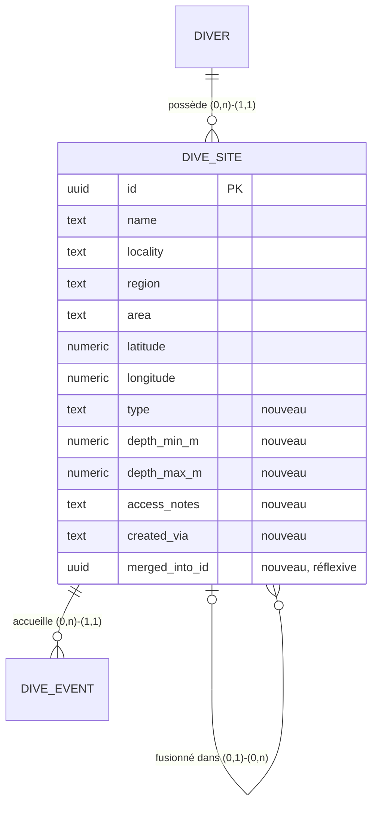

# Évolution du modèle : API des sites

> **Statut : instruit le 2026-11-19** (décisions D-27 à D-33 de `decisions.md`, D31 et D32
> d'`ARCHITECTURE.md`). Mission : `docs/data-model/api-sites-prompt.md`. Mode **évolution** : le
> schéma existant (`schema.md`) n'est pas refait, ce document décrit le delta.

## Contexte

Le front des sites (PR #18, D30) écrit dans un dépôt **en mémoire** superposé au carnet : type,
profondeurs, accès, créations, placements, fusions et suppressions sont perdus au rechargement, et
une fusion n'est jamais répercutée côté API. La spec (`apps/web/design/pages/sites.md`, § Modèle)
décrit un site privé avec nom, région, zone, type, profondeurs, position, accès et origine.

Ce qui existe déjà dans `dive_sites` : `id` (UUID client), `owner_id`, `name`, `locality` (D27),
`region`, `area` (D-20), `latitude` / `longitude` (ensemble ou aucune, D-23), `created_at`,
`updated_at`, `deleted_at` (tombstone, D-03). Les sites sont synchronisés (`DiveSitesService`
`upsert`, `remove`, `pull`), référencés par `dive_events` via la FK composite
`(creator_id, site_id) → dive_sites(owner_id, id)` **ON DELETE RESTRICT**.

## Inventaire (spec → modèle)

| Donnée de la spec            | Écran                                 | Situation                                  | Décision                                                        |
| ---------------------------- | ------------------------------------- | ------------------------------------------ | --------------------------------------------------------------- |
| `name`                       | partout                               | `dive_sites.name`                          | inchangé                                                        |
| `region` (« Calvi · Corse ») | liste, fiche, panneau, express        | `locality` + `region` (D27)                | inchangé ; libellé composé côté front (D-32)                    |
| `zone`                       | puces de zone, fiche                  | **calculée** (`deriveZone`)                | jamais stockée ; `area` (D-20) reste la mer saisie, distincte   |
| `type`                       | express, panneau, fiche, aperçu       | absent                                     | **`type`** `text NULL` + `CHECK` (D-27)                         |
| `depthMinM`, `depthMaxM`     | panneau, fiche (« Infos du site »)    | absent                                     | **`depth_min_m`**, **`depth_max_m`** `numeric(4,1) NULL` (D-27) |
| `latitude`, `longitude`      | carte, panneau, fiche                 | présentes (D-23)                           | inchangées                                                      |
| `accessNotes`                | panneau, fiche (« Accès & conseils ») | absent                                     | **`access_notes`** `text NULL`, 1 à 2 000 caractères (D-27)     |
| `createdVia`                 | « Placer le site » (overline)         | absent, **déduit** par le front            | **`created_via`** `text NOT NULL` `quick`/`full` (D-28)         |
| `createdAt`, `updatedAt`     | fiche (tri, mention)                  | présents en base, absents des contrats     | servis par `GET /api/sites`                                     |
| statistiques                 | fiche, liste, carte                   | calculées par le front depuis `GET /dives` | inchangé (jamais stockées)                                      |
| mise à l'eau, structure      | fiche (« habituelles »)               | `dive_events.entry_type`, `dive_center`    | servies dans `DiveSummary` (D32 d'`ARCHITECTURE.md`)            |
| fusion                       | fiche (« Fusionner avec… »)           | alias **local** source → cible             | **côté serveur**, transaction, `merged_into_id` (D-29, D-30)    |
| suppression                  | fiche (« Supprimer le site »)         | `SiteInUseError` (sync) ; DELETE absent    | `DELETE` refusé s'il reste des plongées **vivantes** (D-31)     |

Pas de géocodage (V2), pas de trait de côte, pas d'endpoint de synchronisation en lot, pas de sites
partagés : hors périmètre.

## Règles de gestion ajoutées

- **RG-31** — Le type d'un site est facultatif et pris dans une liste fermée : `tombant`, `epave`,
  `sec`, `grotte`, `herbier`, `autre`.
- **RG-32** — Les profondeurs d'un site (min, max) sont celles **du site**, pas celles du plongeur ;
  chacune est facultative, en mètres à une décimale ; min ∈ [0 ; 350], max ∈ ]0 ; 350], et
  min ≤ max quand les deux sont saisies (350 = borne de `max_depth_m`, H-10).
- **RG-33** — Les notes d'accès sont un texte libre facultatif, 1 à 2 000 caractères non blancs.
- **RG-34** — Chaque site a une origine immuable : `quick` (créé par son nom depuis le formulaire de
  plongée) ou `full` (créé depuis la page Carte).
- **RG-35** — Fusionner A dans B : toutes les plongées de A (tombstonées comprises) sont rattachées
  à B, les champs vides de B sont complétés par ceux de A, A est supprimé (tombstone) et garde la
  trace de B. A ≠ B, et A et B sont deux sites vivants du même plongeur. Irréversible.
- **RG-36** — Un site fusionné ne revient jamais : une écriture qui le référence (plongée hors
  ligne, sync) est **redirigée** vers sa cible ; la chaîne est toujours réduite à **un saut**.
- **RG-37** — Un site n'est supprimé que s'il n'a **aucune plongée vivante** ; sinon, le plongeur
  doit le fusionner.

## Delta du MCD



Association réflexive **« fusionné dans »** : un site fusionné (0,1) pointe vers un site (0,n)
du **même** propriétaire (RG-35). Elle n'existe que sur une tombstone (RG-36).

## Delta du MLD

```
dive_sites(**id**, #owner_id, name, locality, region, area, latitude, longitude,
           type, depth_min_m, depth_max_m, access_notes, created_via, #merged_into_id,
           created_at, updated_at, deleted_at)
  (owner_id, merged_into_id) → dive_sites(owner_id, id)
```

3FN vérifiée : les nouveaux attributs dépendent de l'identifiant seul. `zone` n'est pas stockée
(dérivable de la position ou de la région, la stocker créerait une anomalie de modification).

## Modèle physique (migration `AddDiveSiteDetails`)

Une seule migration (D-22 : une évolution de la table synchronisée = une montée de version pour la
PWA future). Toutes les nouvelles colonnes sont **nullables et sans défaut**, sauf `created_via`.

| Colonne          | Type           | Null | Contrainte                                                                                                |
| ---------------- | -------------- | ---- | --------------------------------------------------------------------------------------------------------- |
| `type`           | `text`         | oui  | `ck_dive_sites__type` : `type IS NULL OR type IN ('tombant','epave','sec','grotte','herbier','autre')`    |
| `depth_min_m`    | `numeric(4,1)` | oui  | `ck_dive_sites__depth_min_m` : `IS NULL OR BETWEEN 0 AND 350`                                             |
| `depth_max_m`    | `numeric(4,1)` | oui  | `ck_dive_sites__depth_max_m` : `IS NULL OR (> 0 AND <= 350)`                                              |
| —                | —              | —    | `ck_dive_sites__depth_range` : `depth_min_m IS NULL OR depth_max_m IS NULL OR depth_min_m <= depth_max_m` |
| `access_notes`   | `text`         | oui  | `ck_dive_sites__access_notes` : `IS NULL OR char_length(btrim(access_notes)) BETWEEN 1 AND 2000`          |
| `created_via`    | `text`         | non  | `ck_dive_sites__created_via` : `IN ('quick','full')`                                                      |
| `merged_into_id` | `uuid`         | oui  | voir ci-dessous                                                                                           |

`merged_into_id` :

- `fk_dive_sites__owner_id_merged_into_id` : `(owner_id, merged_into_id) → dive_sites(owner_id, id)`
  **ON DELETE NO ACTION** (vérifiée en fin d'instruction : la purge supprime source et cible dans le
  même `DELETE`, voir « Purge »). Ordre `(propriétaire, id)` écrit en SQL brut comme les trois FK
  composites existantes ;
- `ck_dive_sites__merged_into_id_tombstone` : `merged_into_id IS NULL OR deleted_at IS NOT NULL`
  (seule une tombstone a une cible) ;
- `ck_dive_sites__merged_into_id_not_self` : `merged_into_id IS NULL OR merged_into_id <> id` ;
- index partiel `idx_dive_sites__owner_id_merged_into_id` sur `(owner_id, merged_into_id)`
  `WHERE merged_into_id IS NOT NULL` : couvre la FK (vérification à la suppression d'une cible) et la
  réduction des chaînes à la fusion. Partiel : la quasi-totalité des lignes ont `NULL`.

**Backfill de `created_via`** (ajout nullable, `UPDATE`, puis `SET NOT NULL`, dans la même
migration) : `full` si le site a une position, sinon `quick` — la règle que le front applique
aujourd'hui (`docs/sites/plan.md` § 5). Le `down()` supprime les colonnes (perte assumée des
valeurs saisies).

**Pas d'autre index.** `GET /api/sites` lit les sites vivants du plongeur : `uq_dive_sites__owner_id_id`
(préfixe `owner_id`) suffit au volume prévu (quelques centaines de sites, H-14). La réaffectation
des plongées utilise `idx_dive_events__creator_id_site_id`, déjà là.

## Fusion (D-29, D-30)

Une transaction, sur `POST /api/sites/:id/merge` `{ targetId }` :

1. verrouiller source et cible (`FOR UPDATE`) **dans l'ordre des ids** (pas d'interblocage entre
   deux fusions croisées) ; source absente, supprimée ou d'un autre → **404** ; cible = source →
   **422 `merge-into-self`** ; cible absente, supprimée ou d'un autre → **422 `invalid-reference`** ;
2. `UPDATE dive_events SET site_id = :target WHERE creator_id = :owner AND site_id = :source`
   (tombstones comprises : la source doit pouvoir être purgée, et un événement restauré pointe vers
   la cible) ; le trigger `set_updated_at` avance `updated_at` : les autres appareils verront ces
   plongées au prochain pull ;
3. compléter la cible : chaque champ `NULL` de la cible prend la valeur de la source (`locality`,
   `region`, `area`, `type`, `access_notes`) ; la **position** est prise comme une paire (D-23) ;
   les **profondeurs** sont prises champ par champ, sauf si le résultat violerait min ≤ max (la
   cible garde alors les siennes) ; `name` et `created_via` de la cible sont conservés ;
4. réduire les chaînes : `UPDATE dive_sites SET merged_into_id = :target WHERE owner_id = :owner
AND merged_into_id = :source` ;
5. tombstoner la source : `deleted_at = now()`, `merged_into_id = :target`.

Réponse **200** : le site cible complété (`SiteResponse`). Un échec à n'importe quelle étape annule
tout (rollback testé).

### Pourquoi `merged_into_id` (et pas une simple tombstone)

| Option                           | Client hors ligne qui écrit une plongée sur la source après la fusion                                                            |
| -------------------------------- | -------------------------------------------------------------------------------------------------------------------------------- |
| tombstone seule                  | D-12 b **restaure** la source (référence vivante vers un parent supprimé) : la fusion est défaite en silence, le site réapparaît |
| tombstone seule + 422            | la plongée saisie hors ligne est **refusée** : perte de saisie, le client ne sait pas où la rattacher                            |
| **tombstone + `merged_into_id`** | le serveur **redirige** vers la cible (RG-36) ; le pull expose la cible : le client peut réécrire ses références locales         |

Une table d'alias à part (`dive_site_merges`) porterait la même information avec une jointure de
plus et une purge de plus ; la colonne suffit (au plus une cible par site).

### Redirection (RG-36)

- `DivesService.upsertDiveIn` résout `event.siteId` : si le site est une tombstone avec
  `merged_into_id`, la plongée est écrite sur la cible (un seul saut, garanti par l'étape 4), avant
  `assertOwnedReferences` et la restauration D-12 b. `POST`/`PUT /api/dives` héritent de la règle ;
  `DiveWriteService.createSite` laisse un site existant tel quel (`isNew` sur l'id d'une source
  fusionnée → redirigé, jamais recréé).
- `DiveSitesService.upsertIn` (sync) : une écriture sur un site fusionné est **rejetée**
  (`status: 'rejected'`, état serveur renvoyé), comme une restauration en retard (D-12 a) : un site
  fusionné ne se restaure pas.
- REST : `GET`, `PUT`, `DELETE` et `merge` sur une source fusionnée répondent **404** (§9 : supprimé
  = absent). `GET /api/sites` ne liste que les sites vivants. Le front n'a pas besoin de la
  redirection en ligne : il relit les sites et les plongées après la fusion.
- Pull (sync future) : `mergedIntoId` fait partie de l'enregistrement tiré.

## Suppression (D-31)

`DELETE /api/sites/:id` : **204** ; absent, supprimé ou d'un autre → **404** ; une plongée
**vivante** (événement non tombstoné) l'utilise → **409 `site-in-use`** (code existant), que le
front traduit en dialogue de fusion. Des événements **tombstonés** n'empêchent pas la suppression :
la FK `RESTRICT` ne joue qu'à la purge, qui attend leur propre purge (D-12 c). Pas de
`merged_into_id` sur une suppression simple.

## Purge (D-12 c, complétée)

L'étape 4 supprime les `dive_sites` tombstonés sans aucun événement **et** sans site non purgeable
qui les cible (`NOT EXISTS (… merged_into_id = s.id AND NOT purgeable)`). Une source est
tombstonée avant (ou en même temps que) sa cible : en pratique, source et cible partent dans le
même `DELETE`, ce que la FK `NO ACTION` accepte.

## Écriture : contrats et règles

- **Ids générés par le client** (D22) ; tout UUID accepté (le front tire des v4).
- `POST /api/sites` : **201** et le site ; même id, vivant, au **contenu identique** → **200** sans
  écriture ; contenu différent, site supprimé ou id d'un autre → **409 `identifier-conflict`**
  (même corps dans les trois cas, D-24). Sérialisé par le verrou consultatif sur l'id.
- `PUT /api/sites/:id` : remplacement complet (D-22 : **tous les champs requis**, `null` explicite
  compris), **LWW strict** (D-25), `id` de l'URL = `id` du corps ; absent, supprimé ou d'un autre →
  **404** (pas de création par `PUT`). `createdVia` est requis au `POST`, **absent** du `PUT` (RG-34,
  immuable).
- Corps d'écriture : `id`, `name`, `locality`, `region`, `area`, `latitude`, `longitude`, `type`,
  `depthMinM`, `depthMaxM`, `accessNotes` (+ `createdVia` au `POST`). Les DTO couvrent **tous** les
  `CHECK` (D-26) : 400 `validation-failed` avec codes par chemin (`required`, `type`, `length`,
  `min`, `max`, `in`, `pair`, `depth-range`, `matches-route`).
- Réponse `SiteResponse` : les mêmes champs + `createdVia`, `createdAt`, `updatedAt` (ISO UTC). Ni
  `zone` (calculée), ni statistiques (front, depuis le carnet), ni `deletedAt` / `mergedIntoId`
  (sites vivants seulement).

## Libellé de région côté front (D-32)

L'interface ne connaît qu'**un** champ « Région » au libellé composé (`placeLabel` :
« Calvi · Corse »), alors que la base sépare `locality` (D27) et `region`, et porte `area` (D-20),
que les écrans des sites n'affichent pas. Les écrans ne changent pas :

- **lecture** : l'adaptateur HTTP compose `region = placeLabel(locality, region)` (comme le carnet)
  et garde `locality`, `region` brute et `area` dans le `Site` du front (champs non affichés) ;
- **écriture** : si le libellé saisi est **inchangé**, l'adaptateur renvoie `locality` et `region`
  tels quels ; sinon il découpe au **premier** « · » (`« Calvi · Haute-Corse »` → `Calvi` +
  `Haute-Corse` ; sans séparateur → `locality: null`, `region` = le texte) ; `area` est toujours
  renvoyée telle quelle (pas de perte au `PUT` complet).

Option écartée : un champ « Localité » dans les panneaux (changement d'écran, hors mission).

## Impacts

| Lecture / écriture      | Impact                                                                                                                                                                                                            |
| ----------------------- | ----------------------------------------------------------------------------------------------------------------------------------------------------------------------------------------------------------------- |
| `GET /api/sites`        | nouveau : sites **vivants** du plongeur, une requête sur `dive_sites` (`owner_id`, `deleted_at IS NULL`), tri par nom ; pas de plafond (volume H-14)                                                              |
| `GET /api/dives`        | `DiveSummary` gagne `entryType` et `diveCenter` (D32) ; le nom du site suit une fusion (les événements sont réaffectés, rien à faire en lecture)                                                                  |
| `GET /api/dives/:id`    | inchangé ; le site suit la fusion                                                                                                                                                                                 |
| `GET /api/dashboard`    | inchangé (contrat et requêtes) ; il **cesse d'être la source des positions** côté front (`GET /api/sites` les porte)                                                                                              |
| `POST`/`PUT /api/dives` | redirection d'un site fusionné (RG-36) ; un site créé par son nom prend `created_via = 'quick'`                                                                                                                   |
| Sync (services)         | `DiveSiteWrite` gagne `type`, `depthMinM`, `depthMaxM`, `accessNotes` (requis, D-22) et `createdVia` (fixé à la création, ignoré ensuite) ; le pull expose `mergedIntoId` ; écriture sur un site fusionné rejetée |
| Seeds                   | types, profondeurs, accès sur une partie des sites ; « Revellata — Grotte aux Corbs » sans position (`quick`)                                                                                                     |
| RGPD                    | colonnes de localisation et de pratique (`L`), privées comme le site ; aucune dans les logs ; `Cache-Control: no-store` par `CurrentDiverGuard`                                                                   |

## Validation par écran

| Écran                                   | Lecture                                                   | Requêtes                     | Verdict |
| --------------------------------------- | --------------------------------------------------------- | ---------------------------- | ------- |
| Carte : liste, repères, puces de zone   | `GET /api/sites` + `GET /api/dives` (cache partagé)       | 1 + 1 (déjà en cache)        | OK      |
| Fiche site : en-tête, infos, accès, KPI | idem                                                      | 0 de plus                    | OK      |
| Création express                        | `POST /api/sites` (`quick`)                               | 1 transaction                | OK      |
| Panneau Ajouter / Placer / Modifier     | `POST` ou `PUT /api/sites/:id`                            | 1                            | OK      |
| Fusion                                  | `POST /api/sites/:id/merge` puis relecture sites + carnet | 1 transaction (≤ 5 requêtes) | OK      |
| Suppression                             | `DELETE /api/sites/:id` ; 409 → dialogue de fusion        | 1                            | OK      |
| Dashboard, détail de plongée            | inchangés                                                 | —                            | OK      |

## Questions ouvertes

- Redirection d'un **lien** vers une source fusionnée (`/sites/:sourceId` en favori) : 404 en V1 ;
  exposer `mergedIntoId` au `GET /api/sites/:id` d'une tombstone fusionnée si le besoin apparaît.
- Recherche de doublons côté serveur (même nom normalisé) : non, la recherche reste côté front.
