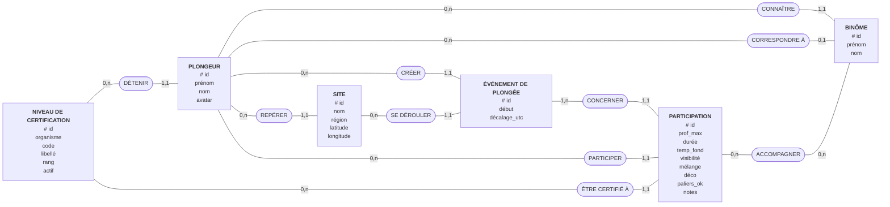
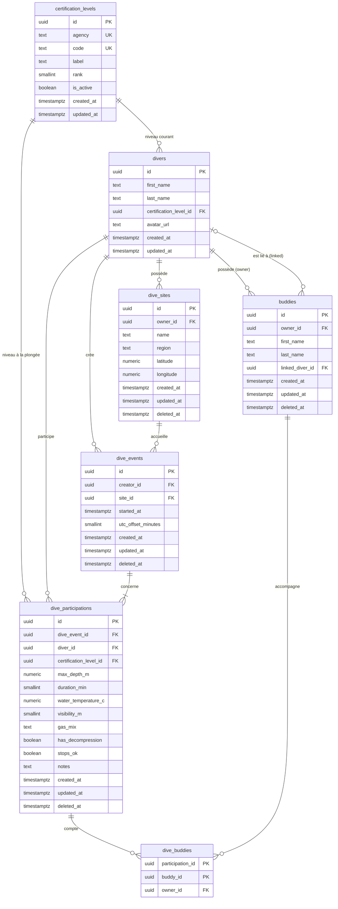

# Modèle de données — E-Deep (carnet de plongée)

> Sources : maquettes `apps/web/design/screenshots/00…05.png` et `mockups/*.jsx` (dashboard
> uniquement), `apps/web/src/features/dashboard/types.ts`, `mocks/dashboard.ts`, `lib/labels.ts`,
> `apps/web/src/app/routes.tsx`, `ARCHITECTURE.md` (§7 migrations, §9 RGPD), révision validée par le
> porteur (`correction-modele-e-deep.md`).
> Mode : **création** (aucune entité ni migration dans `apps/api`).
> Décisions, hypothèses (`H-xx`) et questions ouvertes : voir `decisions.md`.

Périmètre : ce que les écrans et le code montrent aujourd'hui (dashboard + contrat
`DashboardPayload`), plus le découpage événement / participation (D-08) et le référentiel de
niveaux (D-09) décidés pour ne pas avoir à migrer IndexedDB plus tard. Les écrans « Mes plongées »,
« Nouvelle plongée », « Carte », « Statistiques », « Binômes » sont des placeholders : leurs besoins
seront à rejouer contre ce schéma quand ils seront maquettés.

Vocabulaire : une **plongée**, côté front et API, est un agrégat = **événement** (`dive_events` :
site, date, heure locale) + **ma participation** (`dive_participations` : mes mesures, mon niveau,
mes notes) + mes **binômes** (`dive_buddies`).

## 1. Dictionnaire de données

Colonne **PII** : `P` = donnée personnelle, `S` = donnée de santé (RGPD art. 9, cf. `ARCHITECTURE.md`
§9), `L` = localisation (habitudes de lieu), `—` = aucune.

| Entité                  | Attribut                   | Signification                                                   | Type logique                         | Oblig.       | Unique               | PII       | Source                                                      |
| ----------------------- | -------------------------- | --------------------------------------------------------------- | ------------------------------------ | ------------ | -------------------- | --------- | ----------------------------------------------------------- |
| Niveau de certification | id                         | Identifiant                                                     | uuid (serveur)                       | oui          | oui                  | —         | D-09                                                        |
| Niveau de certification | agency                     | Organisme certificateur                                         | texte                                | oui          | avec `code`          | —         | `User.federation` ; « N2 · FFESSM »                         |
| Niveau de certification | code                       | Code court du niveau                                            | texte                                | oui          | avec `agency`        | —         | `User.level` ; « N2 »                                       |
| Niveau de certification | label                      | Libellé complet                                                 | texte                                | oui          | non                  | —         | D-09 (« Niveau 2 »)                                         |
| Niveau de certification | rank                       | Rang de comparaison entre organismes                            | entier                               | oui          | non                  | —         | D-09                                                        |
| Niveau de certification | is_active                  | Niveau proposable à la saisie                                   | booléen                              | oui          | non                  | —         | D-09 (désactivation au lieu de suppression)                 |
| Plongeur                | id                         | Identifiant du compte                                           | uuid                                 | oui          | oui                  | —         | `types.ts > User.id`                                        |
| Plongeur                | first_name                 | Prénom                                                          | texte                                | oui          | non                  | P         | `User.firstName` ; « Bonjour Marine », UserCard             |
| Plongeur                | last_name                  | Nom                                                             | texte                                | oui          | non                  | P         | `User.lastName` ; UserCard « Marine Rousseau »              |
| Plongeur                | certification_level_id     | Niveau **courant**                                              | réf. Niveau                          | oui          | non                  | P         | `User.level` + `User.federation` ; UserCard « N2 · FFESSM » |
| Plongeur                | avatar_url                 | Photo de profil                                                 | texte (URL)                          | non          | non                  | P         | `User.avatarUrl?` (avatar à initiales sinon)                |
| Site                    | id                         | Identifiant du site                                             | uuid (généré client)                 | oui          | oui                  | —         | `DiveSite.id`                                               |
| Site                    | owner_id                   | Plongeur propriétaire                                           | réf. Plongeur                        | oui          | non                  | —         | Réponse Q1 (sites privés)                                   |
| Site                    | name                       | Nom du site                                                     | texte                                | oui          | non                  | L         | `DiveSite.name` ; popover carte, « Dernière plongée »       |
| Site                    | region                     | Région / localité                                               | texte libre                          | oui          | non                  | L         | `DiveSite.region` ; « Calvi, Corse », « Var »               |
| Site                    | latitude                   | Latitude WGS84                                                  | décimal (°)                          | oui          | non                  | L         | `DiveSite.latitude` ; marqueurs de carte                    |
| Site                    | longitude                  | Longitude WGS84                                                 | décimal (°)                          | oui          | non                  | L         | `DiveSite.longitude`                                        |
| Événement de plongée    | id                         | Identifiant                                                     | uuid (généré client)                 | oui          | oui                  | —         | `Dive.id`, route `/dives/:diveId` ; D-08                    |
| Événement de plongée    | creator_id                 | Plongeur qui a saisi l'événement                                | réf. Plongeur                        | oui          | non                  | —         | D-08                                                        |
| Événement de plongée    | site_id                    | Site (du créateur)                                              | réf. Site                            | oui          | non                  | L         | `Dive.site`                                                 |
| Événement de plongée    | started_at                 | Instant de début                                                | date-heure avec fuseau               | oui          | non                  | S         | `Dive.date` (ISO) ; « 08 sept. 2025 », « 14 jours depuis »  |
| Événement de plongée    | utc_offset_minutes         | Décalage UTC de l'heure locale de la plongée                    | entier (min)                         | oui          | non                  | L         | D-10 (résout H-13)                                          |
| Participation           | id                         | Identifiant                                                     | uuid (généré client)                 | oui          | oui                  | —         | D-08                                                        |
| Participation           | dive_event_id              | Événement                                                       | réf. Événement                       | oui          | avec `diver_id`      | —         | D-08                                                        |
| Participation           | diver_id                   | Plongeur participant                                            | réf. Plongeur                        | oui          | avec `dive_event_id` | —         | D-08 ; carnet personnel                                     |
| Participation           | certification_level_id     | Niveau **au moment de la plongée** (snapshot, fixé à la saisie) | réf. Niveau                          | oui          | non                  | P         | badge « Air · N2 » ; D-09 (résout H-06)                     |
| Participation           | max_depth_m                | Profondeur maximale (m)                                         | décimal                              | oui          | non                  | S         | `Dive.depthMaxM` ; « PROF. MAX 42 m »                       |
| Participation           | duration_min               | Durée (min)                                                     | entier                               | oui          | non                  | S         | `Dive.durationMin` ; « DURÉE 38 min »                       |
| Participation           | water_temperature_c        | Température au fond (°C)                                        | décimal                              | non _(H-07)_ | non                  | S         | `Dive.temperatureC` ; « TEMP. FOND 14 °C »                  |
| Participation           | visibility_m               | Visibilité (m)                                                  | entier                               | non _(H-07)_ | non                  | —         | `Dive.visibilityM` ; « VISIBILITÉ 25 m »                    |
| Participation           | gas_mix                    | Mélange respiré                                                 | AIR \| NITROX32 \| NITROX36 \| OTHER | oui          | non                  | S         | `Dive.gasMix`, `labels.ts` ; badge « Air »                  |
| Participation           | has_decompression          | Plongée avec paliers de décompression                           | booléen                              | oui          | non                  | S         | `Dive.hadDecompression`                                     |
| Participation           | stops_ok                   | Paliers respectés (saisie imposée, sans défaut)                 | booléen                              | oui          | non                  | S         | `Dive.stopsOk` ; badge « Palier OK » ; D-11                 |
| Participation           | notes                      | Notes libres                                                    | texte                                | non          | non                  | S         | `Dive.notes?`                                               |
| Binôme                  | id                         | Identifiant du contact                                          | uuid (généré client)                 | oui          | oui                  | —         | `Buddy.id`                                                  |
| Binôme                  | owner_id                   | Plongeur dont c'est le contact                                  | réf. Plongeur                        | oui          | non                  | —         | Réponse Q2                                                  |
| Binôme                  | first_name                 | Prénom du binôme                                                | texte                                | oui          | non                  | P (tiers) | `Buddy.firstName` ; « Lucas Bernard »                       |
| Binôme                  | last_name                  | Nom du binôme                                                   | texte                                | oui          | non                  | P (tiers) | `Buddy.lastName` ; « L. Bernard »                           |
| Binôme                  | linked_diver_id            | Compte E-Deep correspondant, s'il existe                        | réf. Plongeur                        | non          | par propriétaire     | P         | Réponse Q2 (relation réflexive)                             |
| Palanquée               | participation_id, buddy_id | Binôme présent à ma participation                               | association                          | —            | couple               | S         | `Dive.buddies` ; « avec L. Bernard & T. Nguyen »            |

**Champs techniques.** Tables synchronisées (`dive_sites`, `dive_events`, `dive_participations`,
`buddies`) : `created_at`, `updated_at` (horodatage **serveur**, curseur de synchronisation),
`deleted_at` (tombstone). `divers` et `certification_levels` ont `created_at` / `updated_at`, sans
tombstone. `dive_buddies.owner_id` est une copie technique servant aux FK composites (D-04).

**Champs de protocole, non stockés** (D-12) : `base_updated_at` (dernier `updated_at` serveur vu
par le client, envoyé avec chaque enregistrement poussé) et date du dernier pull réussi.

**Non stockés (calculés ou présentation).** « Plongée vivante » = participation **et** événement non
supprimés.

| Donnée affichée                                                  | Source                              | Calcul                                                                                          |
| ---------------------------------------------------------------- | ----------------------------------- | ----------------------------------------------------------------------------------------------- |
| Plongées totales « 127 »                                         | `stats.totalDives`                  | `COUNT(*)` de mes participations vivantes                                                       |
| Temps sous l'eau « 84 h 23 min », « moy. 39 min »                | `stats.totalUnderwaterMinutes`      | `SUM` / `AVG(duration_min)` des participations                                                  |
| Profondeur max « 42 m · Pointe de la Revellata · 08 sept. 2025 » | `stats.maxDepthEver`                | participation de `max_depth_m` maximale ⋈ événement ⋈ site                                      |
| Sites explorés « 23 », « 6 régions »                             | `stats.sitesVisited`                | `COUNT(DISTINCT dive_events.site_id)`, `COUNT(DISTINCT region)` sur mes participations vivantes |
| Plongées par mois (12 mois), « 52 total 12M », « +3 ce mois »    | `divesPerMonth`, `recentMonthDelta` | `GROUP BY date_trunc('month', started_at + utc_offset_minutes)` (mois **local**)                |
| « 14 jours depuis ta dernière plongée »                          | —                                   | `now() - MAX(started_at)`                                                                       |
| Date et heure affichées                                          | `Dive.date`                         | `started_at` décalé de `utc_offset_minutes` (D-10)                                              |
| Marqueur carte : compteur, « -42m PROF. MAX »                    | `DiveSite.diveCount`, `maxDepthM`   | `COUNT`, `MAX(max_depth_m)` par `dive_events.site_id`                                           |
| « 24 plongées » d'un binôme, classement « Binômes fréquents »    | `Buddy.sharedDives`                 | `COUNT` sur `dive_buddies` (participations vivantes)                                            |
| `User.level` / `User.federation`                                 | contrat front                       | dérivés du niveau courant : `code`, `agency` (D-09)                                             |
| Niveau sur le badge « Air · N2 »                                 | —                                   | snapshot `dive_participations.certification_level_id`, choisi à la saisie (D-09)                |
| Initiales « LB »                                                 | `Buddy.initials`                    | dérivées de `first_name` / `last_name`                                                          |
| Couleur d'avatar                                                 | `Buddy.accentColor`                 | présentation, dérivée de l'id côté front (H-09)                                                 |
| Zone « Méditerranée occidentale »                                | `stats.mainArea`                    | origine inconnue → question ouverte n° 8 (`decisions.md`)                                       |

## 2. Règles de gestion

- **RG-01** _(révisée par D-09)_ — Un plongeur a exactement un niveau de certification courant, choisi
  dans le référentiel des niveaux ; le niveau détermine l'organisme (« N2 » est un niveau FFESSM). Un
  niveau peut être détenu par 0 à n plongeurs. Un niveau obsolète est désactivé, jamais supprimé.
- **RG-02** — Un site appartient à un seul plongeur ; un plongeur possède 0 à n sites. Les sites ne
  sont pas partagés entre plongeurs. _(décision utilisateur Q1)_
- **RG-03** _(révisée par D-08)_ — Un événement de plongée est créé par un seul plongeur ; un plongeur
  crée 0 à n événements (état vide du dashboard « Enregistrer ma première plongée »).
- **RG-04** _(révisée par D-08)_ — Un événement se déroule sur exactement un site, qui appartient à
  son créateur ; un site accueille 0 à n événements. _(« 0 » : hypothèse H-04)_
- **RG-05** — Un binôme est un contact appartenant à un seul plongeur ; un plongeur a 0 à n binômes.
  _(décision utilisateur Q2)_
- **RG-06** — Un binôme peut être lié à au plus un compte E-Deep, qui n'est jamais son propriétaire ;
  un compte peut être lié depuis 0 à n contacts (de propriétaires différents). Un même propriétaire
  ne lie un compte donné qu'à un seul de ses contacts vivants. _(Q2 ; unicité : hypothèse H-05)_
- **RG-07** _(révisée par D-08)_ — Une participation compte 0 à n binômes, tous contacts du plongeur
  participant ; un binôme accompagne 0 à n participations. _(« 0 » : hypothèse H-08)_
- **RG-08** — Le mélange d'une participation est l'un de : Air, Nitrox 32, Nitrox 36, Autre.
  _(source `labels.ts`)_
- **RG-09** — Profondeur maximale et durée sont strictement positives ; la visibilité est positive ou
  nulle ; latitude ∈ [-90, 90], longitude ∈ [-180, 180] ; décalage UTC ∈ [-720, 840] minutes.
  _(bornes : hypothèse H-10 ; décalage : D-10)_
- **RG-10** — Lier un binôme à un compte ne donne à ce compte **aucun accès** aux plongées du
  propriétaire. _(hypothèse H-05)_
- **RG-11** — La suppression d'un site, d'une plongée (événement + participation) ou d'un binôme par
  le plongeur est logique (tombstone) jusqu'à la purge ; la suppression du compte efface
  physiquement toutes ses données, sous réserve de RG-22 pour les événements partagés.
  _(D-03, D-07, RGPD)_
- **RG-12** _(révisée par D-08)_ — Un site utilisé par un événement non supprimé ne peut pas être
  supprimé. _(hypothèse H-11)_
- **RG-13** — Toutes les statistiques sont calculées sur les plongées vivantes du plongeur
  (participation et événement non supprimés).
- **RG-14** — En cas de modifications concurrentes d'un même enregistrement (deux appareils), la
  dernière écriture reçue par le serveur l'emporte, enregistrement entier — sauf la résurrection
  d'une tombstone (RG-20). _(décision utilisateur Q3, complétée par D-12)_
- **RG-15** _(révisée par D-08)_ — Une plongée (événement + ma participation + mes binômes) s'écrit
  d'un bloc, dans une transaction.
- **RG-16** _(D-08)_ — Un événement compte 1 à n participations ; un plongeur participe 0 à n
  événements, **au plus une fois** chacun. Une participation retirée puis rajoutée est restaurée,
  pas recréée.
- **RG-17** _(D-08, invariant MVP)_ — Un événement a exactement une participation, celle de son
  créateur. Seul le créateur modifie l'événement ; seul le plongeur concerné modifie sa
  participation.
- **RG-18** _(D-09, révisée)_ — Le niveau d'une participation est fixé à la saisie, côté client :
  le niveau courant du plongeur est proposé, le plongeur peut le modifier. Le serveur conserve la
  valeur fournie et ne copie le niveau courant du plongeur qu'en l'absence de valeur. Il n'est
  jamais mis à jour quand le plongeur change de niveau, mais le plongeur peut le corriger. Il peut
  référencer un niveau désactivé ou supérieur au niveau courant ; seul le niveau courant du plongeur
  doit être actif (RG-01). Une participation référence exactement un niveau ; un niveau est
  référencé par 0 à n participations.
- **RG-19** _(D-10)_ — Un événement porte le décalage UTC de l'heure locale de la plongée ; dates et
  heures s'affichent dans ce décalage, quel que soit le fuseau de l'appareil qui consulte.
- **RG-20** _(D-12)_ — Une écriture qui annulerait une suppression faite après la dernière lecture
  du client est rejetée ; la tombstone est conservée.
- **RG-21** _(D-12)_ — Une plongée écrite qui référence un site ou des binômes supprimés les
  restaure dans la même transaction : aucune référence vivante ne pointe vers un parent supprimé.
- **RG-22** _(D-08, D-07)_ — La suppression du compte du créateur d'un événement n'efface jamais la
  participation des autres plongeurs : c'est une plongée qu'ils ont faite, elle reste dans leur
  carnet. Avant l'effacement, chaque événement qui a d'autres participations vivantes est transféré
  à un autre participant, avec une copie du site dans les sites du nouveau propriétaire ; les
  événements sans autre participation sont supprimés. _(trivialement respectée en MVP, où un
  événement n'a que la participation de son créateur ; conception cible dans D-08)_

## 3. MCD (notation Merise)



| Association                                      | Cardinalités                      | RG                                                              |
| ------------------------------------------------ | --------------------------------- | --------------------------------------------------------------- |
| DÉTENIR (niveau–plongeur, niveau courant)        | Niveau 0,n · Plongeur 1,1         | RG-01                                                           |
| REPÉRER (plongeur–site)                          | Plongeur 0,n · Site 1,1           | RG-02                                                           |
| CRÉER (plongeur–événement)                       | Plongeur 0,n · Événement 1,1      | RG-03                                                           |
| SE DÉROULER (site–événement)                     | Site 0,n · Événement 1,1          | RG-04                                                           |
| CONCERNER (événement–participation)              | Événement 1,n · Participation 1,1 | RG-16 (1 seule en MVP : RG-17)                                  |
| PARTICIPER (plongeur–participation)              | Plongeur 0,n · Participation 1,1  | RG-16                                                           |
| ÊTRE CERTIFIÉ À (niveau–participation, snapshot) | Niveau 0,n · Participation 1,1    | RG-18                                                           |
| CONNAÎTRE (plongeur–binôme, propriétaire)        | Plongeur 0,n · Binôme 1,1         | RG-05                                                           |
| CORRESPONDRE À (binôme–plongeur, compte lié)     | Plongeur 0,n · Binôme 0,1         | RG-06 — réflexive « plongeur ↔ plongeur » portée par le contact |
| ACCOMPAGNER (participation–binôme)               | Participation 0,n · Binôme 0,n    | RG-07                                                           |

**Participation : entité plutôt qu'association porteuse.** PARTICIPATION est sémantiquement une
association porteuse PLONGEUR (0,n) – ÉVÉNEMENT (1,n). Elle est modélisée en entité (identifiant
propre `# id`, deux associations 1,1) parce qu'elle est générée hors ligne, référencée par
ACCOMPAGNER et synchronisée individuellement. L'identifiant naturel `(événement, plongeur)` reste une
clé candidate (`UNIQUE`, RG-16).

**Redondances vérifiées.**

- PLONGEUR → ÉVÉNEMENT → SITE et PLONGEUR → SITE : pas de redondance (un site existe sans
  événement, REPÉRER porte la propriété). La cohérence « le site est celui du créateur » est imposée
  par la FK composite `(creator_id, site_id)`.
- CRÉER et PARTICIPER relient PLONGEUR à la même plongée par deux rôles distincts (saisie /
  pratique). En MVP le créateur et l'unique participant coïncident (RG-17), mais le partage futur
  les sépare : on garde les deux.
- DÉTENIR et ÊTRE CERTIFIÉ À : pas de redondance, l'une est le niveau courant, l'autre le niveau
  à la date de la plongée, choisi à la saisie (snapshot, RG-18) ; ils peuvent légitimement différer.
- CONNAÎTRE et CORRESPONDRE À : rôles distincts (propriétaire / compte lié).

## 4. MLD

```
certification_levels(**id**, agency, code, label, rank, is_active, created_at, updated_at)
divers(**id**, first_name, last_name, #certification_level_id, avatar_url, created_at, updated_at)
dive_sites(**id**, #owner_id, name, region, latitude, longitude, created_at, updated_at, deleted_at)
dive_events(**id**, #creator_id, #site_id, started_at, utc_offset_minutes,
            created_at, updated_at, deleted_at)
dive_participations(**id**, #dive_event_id, #diver_id, #certification_level_id, max_depth_m,
            duration_min, water_temperature_c, visibility_m, gas_mix, has_decompression, stops_ok,
            notes, created_at, updated_at, deleted_at)
buddies(**id**, #owner_id, first_name, last_name, #linked_diver_id, created_at, updated_at, deleted_at)
dive_buddies(**#participation_id, #buddy_id**, #owner_id)
```

- `dive_events.(creator_id, site_id)` → `dive_sites.(owner_id, id)`.
- `dive_buddies.(owner_id, participation_id)` → `dive_participations.(diver_id, id)` ;
  `dive_buddies.(owner_id, buddy_id)` → `buddies.(owner_id, id)`.
- `divers.certification_level_id` et `dive_participations.certification_level_id` →
  `certification_levels.id`.
- `buddies.linked_diver_id` → `divers.id` (rôle « compte lié », distinct de `owner_id`).

**Normalisation.**

- 1FN : pas de liste en colonne (palanquée dans `dive_buddies`).
- 2FN : clé composite unique = `dive_buddies(participation_id, buddy_id)`. `owner_id` dépend de
  `participation_id` seul : **violation 2FN volontaire** (D-04), neutralisée par les deux FK
  composites.
- 3FN : la dépendance transitive `level → federation` de la version précédente est supprimée
  (D-09) : `divers` ne porte plus que `certification_level_id`, l'organisme dépend du niveau dans
  `certification_levels`. `dive_participations` ne contient ni site ni date (dans `dive_events`),
  `dive_events` ne contient ni nom de site ni région (joints). `started_at` n'est **pas** copié dans
  les participations (D-08).
- `dive_participations.certification_level_id` n'est pas une dépendance de `diver_id` : c'est un
  snapshot (niveau à la date de la plongée), donnée historique distincte du niveau courant.
- BCNF : `dive_participations` a deux clés candidates (`id` et `(dive_event_id, diver_id)`), sans
  attribut non-clé déterminant une partie de clé.
- Anomalies sur `dive_participations` / `dive_events` : un site peut exister sans événement ; changer
  la date d'une plongée = 1 UPDATE sur l'événement ; changer de niveau ne réécrit pas l'historique ;
  supprimer la dernière participation d'un site ne supprime pas le site.

## 5. Schéma physique (PostgreSQL 18)



### Types et colonnes

| Table                      | Colonne                    | Type PG      | Null | Défaut              | Note                                                                                 |
| -------------------------- | -------------------------- | ------------ | ---- | ------------------- | ------------------------------------------------------------------------------------ |
| certification_levels       | id                         | uuid         | non  | `uuidv7()`          | référentiel serveur (D-09)                                                           |
| certification_levels       | agency, code               | text         | non  | —                   | 1..40 caractères non blancs ; `UNIQUE (agency, code)`                                |
| certification_levels       | label                      | text         | non  | —                   | 1..120 caractères non blancs                                                         |
| certification_levels       | rank                       | smallint     | non  | —                   | `> 0`                                                                                |
| certification_levels       | is_active                  | boolean      | non  | `true`              |                                                                                      |
| divers                     | id                         | uuid         | non  | `uuidv7()`          | créé en ligne à l'inscription (D-02)                                                 |
| divers                     | first_name, last_name      | text         | non  | —                   | `char_length(btrim(x)) BETWEEN 1 AND 100`                                            |
| divers                     | certification_level_id     | uuid         | non  | —                   | FK certification_levels                                                              |
| divers                     | avatar_url                 | text         | oui  | —                   | `char_length(avatar_url) <= 2048`                                                    |
| dive_sites                 | id                         | uuid         | non  | aucun (client)      | UUIDv7 fourni par le client (D-02)                                                   |
| dive_sites                 | owner_id                   | uuid         | non  | —                   | FK divers                                                                            |
| dive_sites                 | name, region               | text         | non  | —                   | 1..120 caractères non blancs                                                         |
| dive_sites                 | latitude                   | numeric(8,6) | non  | —                   | `BETWEEN -90 AND 90`                                                                 |
| dive_sites                 | longitude                  | numeric(9,6) | non  | —                   | `BETWEEN -180 AND 180`                                                               |
| dive_events                | id                         | uuid         | non  | aucun (client)      |                                                                                      |
| dive_events                | creator_id, site_id        | uuid         | non  | —                   | FK composite vers dive_sites                                                         |
| dive_events                | started_at                 | timestamptz  | non  | —                   | instant UTC                                                                          |
| dive_events                | utc_offset_minutes         | smallint     | non  | —                   | `BETWEEN -720 AND 840` (D-10)                                                        |
| dive_participations        | id                         | uuid         | non  | aucun (client)      |                                                                                      |
| dive_participations        | dive_event_id, diver_id    | uuid         | non  | —                   | `UNIQUE (dive_event_id, diver_id)`                                                   |
| dive_participations        | certification_level_id     | uuid         | non  | —                   | snapshot fourni par le client ; à défaut, niveau courant copié par le service (D-09) |
| dive_participations        | max_depth_m                | numeric(4,1) | non  | —                   | `> 0 AND <= 350`                                                                     |
| dive_participations        | duration_min               | smallint     | non  | —                   | `> 0 AND <= 1440`                                                                    |
| dive_participations        | water_temperature_c        | numeric(3,1) | oui  | —                   | `BETWEEN -5 AND 45`                                                                  |
| dive_participations        | visibility_m               | smallint     | oui  | —                   | `BETWEEN 0 AND 100`                                                                  |
| dive_participations        | gas_mix                    | text         | non  | —                   | `IN ('AIR','NITROX32','NITROX36','OTHER')`                                           |
| dive_participations        | has_decompression          | boolean      | non  | `false`             |                                                                                      |
| dive_participations        | stops_ok                   | boolean      | non  | **aucun**           | saisie imposée (D-11)                                                                |
| dive_participations        | notes                      | text         | oui  | —                   | `char_length <= 5000`                                                                |
| buddies                    | id                         | uuid         | non  | aucun (client)      |                                                                                      |
| buddies                    | owner_id                   | uuid         | non  | —                   | FK divers                                                                            |
| buddies                    | first_name, last_name      | text         | non  | —                   | 1..100 caractères non blancs                                                         |
| buddies                    | linked_diver_id            | uuid         | oui  | —                   | FK divers, `<> owner_id`                                                             |
| dive_buddies               | participation_id, buddy_id | uuid         | non  | —                   | PK composite                                                                         |
| dive_buddies               | owner_id                   | uuid         | non  | —                   | copie technique pour FK composites                                                   |
| _toutes sauf dive_buddies_ | created_at                 | timestamptz  | non  | `now()`             |                                                                                      |
| _toutes sauf dive_buddies_ | updated_at                 | timestamptz  | non  | `clock_timestamp()` | posé par **trigger** à chaque INSERT/UPDATE (D-03)                                   |
| _synchronisées_            | deleted_at                 | timestamptz  | oui  | —                   | tombstone                                                                            |

### Données initiales (migration)

`certification_levels` : uniquement ce que les sources attestent (D-09).

| agency | code | label    | rank |
| ------ | ---- | -------- | ---- |
| FFESSM | N1   | Niveau 1 | 10   |
| FFESSM | N2   | Niveau 2 | 20   |
| FFESSM | N3   | Niveau 3 | 30   |
| FFESSM | N4   | Niveau 4 | 40   |

La liste complémentaire (CMAS, PADI, SSI) est une **proposition à valider** dans `decisions.md`
(D-09), non insérée.

## 6. Contraintes et index

### Contraintes

| Table                | Nom                                                                                        | Définition                                                                                    | Justification                                                                                                        |
| -------------------- | ------------------------------------------------------------------------------------------ | --------------------------------------------------------------------------------------------- | -------------------------------------------------------------------------------------------------------------------- |
| certification_levels | uq_certification_levels__agency_code                                                       | `UNIQUE (agency, code)`                                                                       | un code par organisme                                                                                                |
| certification_levels | ck_certification_levels__agency / __code / __label                                         | longueurs non blanches                                                                        |                                                                                                                      |
| certification_levels | ck_certification_levels__rank                                                              | `rank > 0`                                                                                    |                                                                                                                      |
| divers               | fk_divers__certification_level_id                                                          | → certification_levels(id) **ON DELETE RESTRICT**                                             | RG-01 : un niveau se désactive, il ne se supprime pas                                                                |
| divers               | ck_divers__first_name / __last_name                                                        | `char_length(btrim(x)) BETWEEN 1 AND 100`                                                     | nom non vide                                                                                                         |
| divers               | ck_divers__avatar_url                                                                      | `avatar_url IS NULL OR char_length(avatar_url) <= 2048`                                       |                                                                                                                      |
| dive_sites           | fk_dive_sites__owner_id                                                                    | → divers(id) **ON DELETE CASCADE**                                                            | RG-02, RG-11                                                                                                         |
| dive_sites           | uq_dive_sites__owner_id_id                                                                 | `UNIQUE (owner_id, id)`                                                                       | cible de FK composite (D-04)                                                                                         |
| dive_sites           | ck_dive_sites__latitude / __longitude                                                      | bornes WGS84                                                                                  | RG-09                                                                                                                |
| dive_sites           | ck_dive_sites__name / __region                                                             | 1..120 caractères non blancs                                                                  |                                                                                                                      |
| dive_events          | fk_dive_events__creator_id                                                                 | → divers(id) **ON DELETE CASCADE**                                                            | RG-03, RG-11 ; MVP seulement : passera en **RESTRICT** avec le partage, après transfert des événements (RG-22, D-08) |
| dive_events          | fk_dive_events__creator_id_site_id                                                         | (creator_id, site_id) → dive_sites(owner_id, id) **ON DELETE RESTRICT**                       | RG-04 (site du créateur), RG-12 (purge d'un site référencé impossible)                                               |
| dive_events          | ck_dive_events__utc_offset_minutes                                                         | `utc_offset_minutes BETWEEN -720 AND 840`                                                     | RG-09, D-10                                                                                                          |
| dive_participations  | fk_dive_participations__dive_event_id                                                      | → dive_events(id) **ON DELETE CASCADE**                                                       | composition : la participation suit l'événement                                                                      |
| dive_participations  | fk_dive_participations__diver_id                                                           | → divers(id) **ON DELETE CASCADE**                                                            | RG-11                                                                                                                |
| dive_participations  | fk_dive_participations__certification_level_id                                             | → certification_levels(id) **ON DELETE RESTRICT**                                             | RG-18                                                                                                                |
| dive_participations  | uq_dive_participations__dive_event_id_diver_id                                             | `UNIQUE (dive_event_id, diver_id)` (tombstones incluses)                                      | RG-16                                                                                                                |
| dive_participations  | uq_dive_participations__diver_id_id                                                        | `UNIQUE (diver_id, id)`                                                                       | cible de FK composite de `dive_buddies`                                                                              |
| dive_participations  | ck_dive_participations__max_depth_m, __duration_min, __water_temperature_c, __visibility_m | voir types                                                                                    | RG-09                                                                                                                |
| dive_participations  | ck_dive_participations__gas_mix                                                            | `gas_mix IN (...)`                                                                            | RG-08                                                                                                                |
| dive_participations  | ck_dive_participations__notes                                                              | `notes IS NULL OR char_length(notes) <= 5000`                                                 | borne technique                                                                                                      |
| buddies              | fk_buddies__owner_id                                                                       | → divers(id) **ON DELETE CASCADE**                                                            | RG-05, RG-11                                                                                                         |
| buddies              | fk_buddies__linked_diver_id                                                                | → divers(id) **ON DELETE SET NULL**                                                           | RG-06                                                                                                                |
| buddies              | ck_buddies__not_self                                                                       | `linked_diver_id IS NULL OR linked_diver_id <> owner_id`                                      | RG-06                                                                                                                |
| buddies              | uq_buddies__owner_id_linked_diver_id                                                       | `UNIQUE (owner_id, linked_diver_id) WHERE linked_diver_id IS NOT NULL AND deleted_at IS NULL` | RG-06                                                                                                                |
| buddies              | uq_buddies__owner_id_id                                                                    | `UNIQUE (owner_id, id)`                                                                       | cible de FK composite                                                                                                |
| dive_buddies         | pk_dive_buddies                                                                            | `PRIMARY KEY (participation_id, buddy_id)`                                                    | un binôme une fois par participation                                                                                 |
| dive_buddies         | fk_dive_buddies__owner_id_participation_id                                                 | → dive_participations(diver_id, id) **ON DELETE CASCADE**                                     | composition : la palanquée suit la participation                                                                     |
| dive_buddies         | fk_dive_buddies__owner_id_buddy_id                                                         | → buddies(owner_id, id) **ON DELETE CASCADE**                                                 | purge d'un contact = retrait de ses participations                                                                   |
| dive_buddies         | fk_dive_buddies__owner_id                                                                  | → divers(id) **ON DELETE CASCADE**                                                            | cohérence, effacement du compte                                                                                      |

Aucune contrainte SQL n'impose `dive_participations.diver_id = dive_events.creator_id` ni « une seule
participation par événement » : ce sont des invariants **MVP** tenus par les services (RG-17), qui
seront levés avec le partage (D-08).

### Index

| Table               | Nom                                             | Définition                                            | Justification                                                                                                        |
| ------------------- | ----------------------------------------------- | ----------------------------------------------------- | -------------------------------------------------------------------------------------------------------------------- |
| dive_participations | idx_dive_participations__diver_id_dive_event_id | `(diver_id, dive_event_id) WHERE deleted_at IS NULL`  | Dashboard : toutes les statistiques partent de mes participations vivantes puis joignent l'événement par PK (D-08)   |
| dive_participations | idx_dive_participations__diver_id_updated_at_id | `(diver_id, updated_at, id)`                          | Pull de synchronisation (tombstones incluses)                                                                        |
| dive_events         | idx_dive_events__creator_id_updated_at_id       | `(creator_id, updated_at, id)`                        | Pull de synchronisation ; couvre la FK `creator_id`                                                                  |
| dive_events         | idx_dive_events__creator_id_site_id             | `(creator_id, site_id)`                               | FK composite (contrôle RESTRICT), refus de suppression d'un site utilisé (RG-12), `NOT EXISTS` de la purge des sites |
| dive_sites          | idx_dive_sites__owner_id_updated_at_id          | `(owner_id, updated_at, id)`                          | Pull ; la FK `owner_id` est couverte par `uq_dive_sites__owner_id_id`                                                |
| buddies             | idx_buddies__owner_id_updated_at_id             | `(owner_id, updated_at, id)`                          | Pull                                                                                                                 |
| buddies             | idx_buddies__linked_diver_id                    | `(linked_diver_id) WHERE linked_diver_id IS NOT NULL` | FK `ON DELETE SET NULL` à la suppression d'un compte                                                                 |
| dive_buddies        | idx_dive_buddies__owner_id_buddy_id             | `(owner_id, buddy_id)`                                | FK composite vers buddies ; « Binômes fréquents »                                                                    |

FK couvertes par un index existant : `dive_participations.dive_event_id` (par
`uq_dive_participations__dive_event_id_diver_id`), `dive_participations.diver_id` (par
`uq_dive_participations__diver_id_id`), `dive_buddies.(owner_id, participation_id)` (PK, colonne
`participation_id` en tête), `dive_buddies.owner_id` (par `idx_dive_buddies__owner_id_buddy_id`).

**FK volontairement non indexées** : `divers.certification_level_id` et
`dive_participations.certification_level_id`. Un index de FK ne sert qu'au contrôle `RESTRICT` lors
de la suppression d'un niveau, or les niveaux ne sont jamais supprimés (désactivation, RG-01) ni
purgés (D-12). Aucun écran ne filtre par niveau. À ajouter si une statistique « plongées par niveau »
apparaît.

Pas d'index sur `dive_events.started_at` : les requêtes du dashboard partent des participations du
plongeur (quelques milliers au plus, H-14) et joignent l'événement par PK (D-08).

### Triggers (SQL brut)

- `set_updated_at()` : `BEFORE INSERT OR UPDATE` sur `certification_levels`, `divers`, `dive_sites`,
  `dive_events`, `dive_participations`, `buddies` : `NEW.updated_at := clock_timestamp()`. Le
  serveur est seul maître de `updated_at` (D-03).
- `touch_participation_on_buddies_change()` : `AFTER INSERT OR DELETE` sur `dive_buddies`, fait
  avancer `dive_participations.updated_at` de la participation concernée (D-04). Pendant une cascade
  (suppression de compte, purge), la participation est déjà supprimée : l'UPDATE ne touche aucune
  ligne et ne lève pas d'erreur (vérifié sur PostgreSQL 18, à couvrir par les tests, D-12 e).
