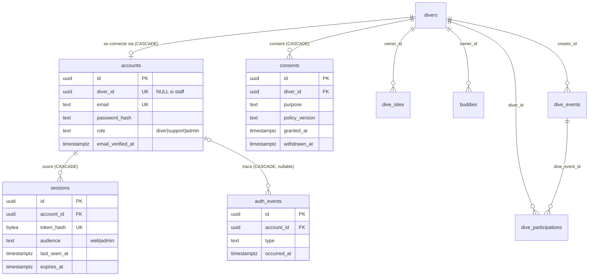

# Plan : authentification et rattachement des données au plongeur

Statut : **terminé le 2026-11-27** (lots 0 à 8 livrés : lot 0 PR #22 et lot 1 PR #23 le 2026-11-20 ; lots 2 à 5 PR #24 à #27 le 2026-11-24 ; lot 6a PR #28, CI PR #29 et lot 6b PR #30 le 2026-11-26 ; lot 7 PR #31 le 2026-11-27 ; lot 8, documentation, le 2026-11-27). **Validé le 2026-11-20**, **révisé le même jour** pour intégrer la maquette d'accueil (`apps/web/design/pages/accueil.md`, captures 50 à 53, `accueil-prompt.md`) : D33, D35 à D39 et D41 amendées, D45 ajoutée, lots 1 à 6 complétés. Ce plan prime sur les prompts de lot. Il est subordonné à `CLAUDE.md` puis à `ARCHITECTURE.md` : un conflit se signale, il ne se tranche pas en silence.

> **Skills** : `design-patterns-pro` et `typescript-excellence`, cités par les briefs, n'existent pas dans l'environnement. Ils sont remplacés par `writing-clean-code` (patterns, SOLID) et `developing-typescript` (typage strict). `scss-expert` est remplacé par `developing-scss`.

## 0. État des lieux (résumé)

| Zone      | Constat                                                                                                                                                                                                                                                                                                                                                                                                                                                                                                                                                                                                                                                                                      |
| --------- | -------------------------------------------------------------------------------------------------------------------------------------------------------------------------------------------------------------------------------------------------------------------------------------------------------------------------------------------------------------------------------------------------------------------------------------------------------------------------------------------------------------------------------------------------------------------------------------------------------------------------------------------------------------------------------------------- |
| Données   | `dive_sites.owner_id`, `buddies.owner_id`, `dive_events.creator_id`, `dive_participations.diver_id`, `dive_buddies.owner_id` (FK composites `(propriétaire, id)`) et `dive_observations` via la participation. Toutes les FK vers `divers` sont en `CASCADE`, sauf `buddies.linked_diver_id`, en `SET NULL`. **Aucune colonne propriétaire n'est à créer ni à remplir.**                                                                                                                                                                                                                                                                                                                     |
| Identité  | `divers` n'a ni email ni identifiant de connexion, et aucune unicité. D28 a écarté une entité `User`.                                                                                                                                                                                                                                                                                                                                                                                                                                                                                                                                                                                        |
| Garde     | `common/auth/current-diver.guard.ts` (stub, `no-store`, 401) posé par `@UseGuards` sur 3 contrôleurs. Pas d'`APP_GUARD`. Les services filtrent tous par `diverId`. Une ressource d'autrui donne une 404 générique, une référence d'autrui une 422.                                                                                                                                                                                                                                                                                                                                                                                                                                           |
| Partage   | Événement + participations (D-08), avec la règle « un seul participant » dans les services. `pullEvents` lit déjà « où je participe ».                                                                                                                                                                                                                                                                                                                                                                                                                                                                                                                                                       |
| Infra API | CORS avec allowlist et sans credentials. Absents : `trust proxy`, `x-powered-by` désactivé, passport, jwt, throttler, cookie-parser, argon2. Un `NODE_ENV` absent vaut `development`.                                                                                                                                                                                                                                                                                                                                                                                                                                                                                                        |
| Web       | `apiClient` maison sans `credentials`, appelé en cross-origin (`:3000`), sans proxy Vite. TanStack Query est adopté (D24). React Router en mode data, **sans loader**. `mockUser` est utilisé par `AppShell`, `DivesPage`, `DiveDetailPage`, `DiveFormPage` et `SiteDetailPage`. `/logout` et `/settings` sont des placeholders. Le brouillon de plongée est en clair, sous une clé sans plongeur. Maquette de l'accueil public, de la connexion et de l'inscription : `design/pages/accueil.md` (spec), `mockups/welcome.jsx`, captures 50 à 53, prompt par phases `design/prompts/accueil-prompt.md`. **Aucune maquette** pour `/welcome`, le re-consentement ni les paramètres du compte. |
| Admin     | Pas de router, une seule page, client GET seul. `app/access-control/README.md` décrit la cible (`SessionContext`, `useSession`, `canAccess`, 401 / 403).                                                                                                                                                                                                                                                                                                                                                                                                                                                                                                                                     |
| Tests     | unit ~140 · e2e sans base ~45 (vrai contrôleur, vrai garde, `DataSource` et `ConfigService` simulés, `configureApp`) · db ~160 (PostgreSQL réel, base `_test`).                                                                                                                                                                                                                                                                                                                                                                                                                                                                                                                              |

## 1. Résumé et décisions

On construit une **authentification maison par session serveur opaque**, sans nouvelle dépendance dans l'API :

- deux audiences (web plongeur et admin staff), chacune avec son cookie `__Host-` ;
- l'API est servie à la **même origine** que chaque front ;
- les mots de passe sont hachés en Argon2id natif ;
- un garde global refuse par défaut ;
- le consentement santé est versionné ;
- la V1 est une **bêta fermée sans email** ;
- l'accueil public de la maquette porte la connexion et une inscription minimale ; le niveau et le consentement santé sont recueillis au premier lancement (`/welcome`).

Le carnet reste mono-participant. Le partage est une feature distincte.

Les lignes suivantes sont prêtes à être ajoutées au §10 d'`ARCHITECTURE.md` (lot 8).

Décisions prises avec l'authentification (**2026-11-20**). Détail : `docs/plans/auth.md`.

| #   | Décision                                                                                                                                                                                                                                                                                                                                                                                                                                                                                                                                                                                                                                                                                                                                                                                                                                                                                                                                                                                                                                                                                                                                                                                                                                                                                                                         | Raison                                                                                                                                                                                                                                                                                                                                                                                                                                                                                                                                                            |
| --- | -------------------------------------------------------------------------------------------------------------------------------------------------------------------------------------------------------------------------------------------------------------------------------------------------------------------------------------------------------------------------------------------------------------------------------------------------------------------------------------------------------------------------------------------------------------------------------------------------------------------------------------------------------------------------------------------------------------------------------------------------------------------------------------------------------------------------------------------------------------------------------------------------------------------------------------------------------------------------------------------------------------------------------------------------------------------------------------------------------------------------------------------------------------------------------------------------------------------------------------------------------------------------------------------------------------------------------- | ----------------------------------------------------------------------------------------------------------------------------------------------------------------------------------------------------------------------------------------------------------------------------------------------------------------------------------------------------------------------------------------------------------------------------------------------------------------------------------------------------------------------------------------------------------------- |
| D33 | **Authentification maison par session serveur opaque.** Le token est fait de 32 octets aléatoires en base64url, dans un cookie `HttpOnly`. La base n'en garde que le `SHA-256`, dans la table `sessions`. Chaque requête lit la session par index unique et en tire un `AuthContext { accountId, diverId \| null, role, sessionId }`. **Le code métier ne lit que ce contexte**, jamais le cookie. Le token est tourné au login et toutes les sessions sont révoquées au changement de mot de passe. « Rester connecté » (`rememberMe`, coché par défaut) : coché, cookie persistant et session web de 30 jours d'inactivité et 180 jours au maximum ; décoché, cookie de session du navigateur (sans `Max-Age`) et expiration absolue à 24 h. Il n'y a ni JWT, ni refresh token, ni librairie (Better Auth, passport) ni fournisseur d'identité (Keycloak, Auth0).                                                                                                                                                                                                                                                                                                                                                                                                                                                              | Une seule API et une seule base : le JWT n'apporterait aucune vérification sans état utile. La session donne une révocation immédiate (logout, suppression de compte, données de santé), rien à faire au rechargement, aucune course entre onglets et aucune dépendance. Une librairie imposerait ses propres migrations (conflit avec D7 et §7). Un IdP coûterait trop en exploitation (Keycloak) ou impliquerait un tiers US (Auth0). Isoler l'`AuthContext` limite une éventuelle bascule vers des tokens à un seul lot : garde, routes d'auth et `apiClient`. |
| D34 | **Même origine.** En prod, un reverse proxy sert `app.<domaine>` et `admin.<domaine>`, chacun avec son `/api`. En dev, le proxy Vite redirige `/api` vers `:3000` et `VITE_API_BASE_URL=/api`. Les cookies sont host-only : `__Host-edeep_sid` (web) et `__Host-edeep_admin_sid` (admin), en `Secure` et `SameSite=Strict`. En dev, ils s'appellent `edeep_sid` et `edeep_admin_sid`, sans `Secure`, selon `SESSION_COOKIE_SECURE`, qui vaut `true` par défaut. **Le CORS est retiré.** Un `OriginGuard` global exige, sur les méthodes non sûres, `Sec-Fetch-Site: same-origin`, ou à défaut un `Origin` présent dans `ALLOWED_ORIGINS`. Le corps doit être en JSON. `trust proxy` est réglé par `TRUST_PROXY` et `x-powered-by` est désactivé.                                                                                                                                                                                                                                                                                                                                                                                                                                                                                                                                                                                 | Il n'y a plus de preflight (éco-conception), plus de `credentials` cross-origin, et l'isolation entre web et admin est naturelle. `SameSite=Strict` plus le contrôle d'origine plus le JSON couvrent le CSRF sans token. En dev, localhost partage les cookies entre les ports : d'où deux noms distincts.                                                                                                                                                                                                                                                        |
| D35 | **Mots de passe** hachés en Argon2id via `node:crypto.argon2`, appel asynchrone (m = 19 456 KiB, t = 2, p = 1, sel de 16 octets, tag de 32 octets), stockés au format PHC et re-hachés au login si les paramètres changent. Politique : 15 à 128 caractères après normalisation NFKC, aucune règle de composition, une liste locale de mots de passe compromis, refus s'il contient l'email ou le nom, pas d'appel à HIBP. **Elle remplace les critères de la maquette d'accueil** (10 caractères, une majuscule, un chiffre ; choix du porteur, 2026-11-20) : la jauge et les critères en direct mesurent la longueur (bloquant à 15) ; la liste de compromis et l'identité sont vérifiées par l'API à l'envoi (`fieldErrors.password`). **Limitation maison en mémoire** : par IP, et par email normalisé et haché, que le compte existe ou non. Réponse 429 `too-many-attempts` avec `Retry-After`. Login : toujours `401 invalid-credentials`, avec un hash factice calculé si l'email est inconnu.                                                                                                                                                                                                                                                                                                                          | Disponible nativement sur Node 26.13 (vérifié), donc aucune dépendance et aucun `allowBuilds` (D5). Paramètres conformes à OWASP. Longueur conforme à NIST 800-63B rev. 4 (au moins 15 en facteur unique, au moins 64 acceptés) et à la CNIL. La limitation par email existe aussi pour un email inconnu : un 429 ne révèle donc pas l'existence d'un compte. Une instance unique suffit ; un redémarrage remet les compteurs à zéro, c'est accepté.                                                                                                              |
| D36 | **Table `accounts` séparée de `divers`** (`diver_id` UNIQUE nullable, `CASCADE`). Email en `text` normalisé (`lower` + `btrim`, `CHECK`, UNIQUE), sans `citext`. Rôle `diver \| support \| admin` en `text` + `CHECK`, avec la contrainte `(role = 'diver') = (diver_id IS NOT NULL)` : **un compte staff n'a pas de plongeur**. **Amende D28** : `Diver` reste le propriétaire des données, et `Account` n'est qu'un moyen de connexion. **Profil incomplet** : l'inscription minimale de la maquette (prénom, email, mot de passe) crée le plongeur sans nom ni niveau ; la migration `AllowIncompleteDiverProfile` rend `divers.last_name` et `divers.certification_level_id` nullables. Le niveau est obligatoire à `/welcome` (D38) avant tout accès au carnet.                                                                                                                                                                                                                                                                                                                                                                                                                                                                                                                                                             | Sépare l'authentification du profil : le futur pull de `divers` ne portera jamais de hash. Le compte staff est distinct du compte plongeur (séparation des privilèges). L'effacement (art. 17) reste un `DELETE divers` qui descend en cascade. Une migration purement additive : impossible de remplir un email pour les plongeurs existants.                                                                                                                                                                                                                    |
| D37 | **Refus par défaut.** Un `SessionGuard` global (`APP_GUARD`) exige une session sur toute route. Exceptions explicites : `@Public()`, `@Roles(...)` et `@AllowIncompleteProfile()` (routes du compte accessibles avant `/welcome` ou sans consentement à jour). L'audience se déduit du chemin : `/api/admin/*` n'accepte que le cookie admin, le reste que le cookie web. `Cache-Control: no-store` est posé sur toute route non publique. `@CurrentDiverId()` reste, renvoie un `DiverId` typé (brandé), et répond 403 pour un compte staff. Un **test d'inventaire** énumère toutes les routes et les compare à la liste figée des routes publiques. On garde la 404 générique. Le 403 est réservé à un rôle insuffisant, au profil incomplet (`onboarding-required`) et au consentement périmé (`consent-required`).                                                                                                                                                                                                                                                                                                                                                                                                                                                                                                          | Un oubli de décorateur ne peut plus exposer une route. Le type `DiverId` empêche de passer un id venu du client à un service. Le test casse dès qu'une route publique est ajoutée sans être déclarée.                                                                                                                                                                                                                                                                                                                                                             |
| D38 | **Consentement santé** (art. 9.2.a) : table `consents` (`purpose`, `policy_version`, `granted_at`, `withdrawn_at`). **Recueilli à `/welcome`** (premier lancement, écran réel et non plus placeholder), avec le niveau et le nom facultatif, par une case dédiée, non pré-cochée et obligatoire ; l'inscription ne porte que la mention CGU et confidentialité de la maquette, car aucune donnée de santé n'existe avant `/welcome`. La version est un **type littéral** dans `@e-deep/shared` (`HealthPolicyVersion`). Sans niveau ou sans consentement, réponse `403 onboarding-required` (redirection vers `/welcome`) ; avec un consentement d'une version périmée, `403 consent-required` (re-consentement). **Retirer son consentement = supprimer son compte** (`DELETE /api/me`, après re-saisie du mot de passe, via `DiversService.deleteAccount`).                                                                                                                                                                                                                                                                                                                                                                                                                                                                    | Sans base légale, le carnet ne peut plus être conservé : un seul chemin, sans état intermédiaire ni planificateur. Une version typée oblige le texte du front et l'API à évoluer ensemble.                                                                                                                                                                                                                                                                                                                                                                        |
| D39 | **V1 sans email** : bêta fermée (`REGISTRATION_ENABLED=false` par défaut, sinon `403 registration-closed`). La réinitialisation passe par une commande d'exploitation (`account:reset-password`). `409 email-taken` à l'inscription (énumération acceptée en bêta fermée). **Le lot email** (vérification, réinitialisation, inscription non énumérante en 202, fournisseur UE appelé par `fetch`) **doit être livré avant d'ouvrir l'inscription au public**. Côté web, le drapeau `features.signup` (`shared/config/app.ts`), aligné sur `REGISTRATION_ENABLED`, remplace l'onglet et les boutons d'inscription de l'accueil par « Inscriptions bientôt ouvertes », et `/signup` redirige vers `/login` ; l'API reste l'autorité. « Mot de passe oublié ? » mène à une page placeholder qui invite à contacter le support.                                                                                                                                                                                                                                                                                                                                                                                                                                                                                                     | Évite en V1 un fournisseur, des DNS SPF/DKIM/DMARC et un lot. La dette est bornée par le flag.                                                                                                                                                                                                                                                                                                                                                                                                                                                                    |
| D40 | **Journalisation** : logs Nest réduits au nom de l'événement et à un code de raison, **sans** id, email, IP, user-agent ni token. Table `auth_events` (`account_id` nullable, `type`, `occurred_at`), sans IP, purgée après 180 jours par `PurgeService`.                                                                                                                                                                                                                                                                                                                                                                                                                                                                                                                                                                                                                                                                                                                                                                                                                                                                                                                                                                                                                                                                        | Traçabilité recommandée par la CNIL (6 mois à 1 an) sans donnée réseau. Pseudonymiser l'id n'apporterait rien : il resterait une donnée personnelle.                                                                                                                                                                                                                                                                                                                                                                                                              |
| D41 | **Web** : `GET /api/me` est la source de l'identité. Un loader `requireSession` sur le layout protégé appelle `ensureQueryData(meQuery)`. Un 401 renvoie vers `/login?next=` (`next` interne uniquement). Tout 401 attrapé globalement vide le cache puis renvoie au login. Le logout est une action de route : il vide le cache, purge les brouillons et prévient les autres onglets par `BroadcastChannel`. Brouillons rangés sous `e-deep:dive-draft:<diverId>:<mode>`. `mockUser` disparaît du code de prod. Routes publiques `/`, `/login`, `/signup`, `/forgot-password` et pages légales, avec un loader `redirectIfAuthenticated` (vers `/dashboard`) ; après inscription, `/welcome`. Les appels passent par le port **`authClient`** (`login`, `signup`, `logout`, `me`, sans `refresh`) : adaptateur HTTP en prod, faux en mémoire pour les tests et le forçage `?state=`, **jamais de session simulée dans le bundle**. L'identité se lit par `useMe()` / `useCurrentDiver()` au-dessus de TanStack Query, sans état propre ; les actions passent par des hooks dédiés (`useLogin`, `useSignup`, `useCompleteOnboarding`…). _Correction du lot 8 : le hook `useAuth()` prévu ici a été retiré au lot 6a, et le loader lit `/me` par `fetchQuery` (pas `ensureQueryData`), pour relire l'API après une invalidation._ | Ferme les points ouverts §11 « identité » et « brouillon RGPD (clé) ». Pas de token côté JS, donc pas de refresh ni de file de rejeu.                                                                                                                                                                                                                                                                                                                                                                                                                             |
| D42 | **Admin** : React Router en mode data (fin de D9 côté admin), sans TanStack Query. Sessions staff courtes (30 min d'inactivité, 8 h au maximum). **TOTP obligatoire pour le staff** (RFC 6238 natif, secret chiffré en AES-256-GCM avec `TOTP_ENCRYPTION_KEY`), activé à la création du compte par la commande d'exploitation (`account:create-staff`), ré-enrôlé par `account:reset-totp` _(complété au lot 8)_. **Aucune route admin ne lit de données de santé.**                                                                                                                                                                                                                                                                                                                                                                                                                                                                                                                                                                                                                                                                                                                                                                                                                                                             | Deuxième page admin (login), condition de D9. Les sessions web sont longues (30 jours d'inactivité, 180 jours au maximum) parce que la PWA hors ligne (D22) en a besoin ; le staff n'a pas ce besoin.                                                                                                                                                                                                                                                                                                                                                             |
| D43 | **Partage hors périmètre** : la règle « un seul participant » est maintenue, et aucune route ne permet de chercher ou de lier un autre compte. Le modèle cible (§8 de ce plan) est consigné dans D-08.                                                                                                                                                                                                                                                                                                                                                                                                                                                                                                                                                                                                                                                                                                                                                                                                                                                                                                                                                                                                                                                                                                                           | Le partage demande son propre consentement (données de santé d'un tiers), RG-22 et le pull élargi : c'est une feature à part entière.                                                                                                                                                                                                                                                                                                                                                                                                                             |
| D44 | **`DEV_AUTH_STUB` supprimé** (variable, validation, branche du garde) au lot 6. Les tests sans base remplacent `SessionService` par un faux. Le seed crée de vrais comptes (`@example.test`, mot de passe lu dans `SEED_PASSWORD`, sans valeur par défaut). Le staff est créé par la commande `account:create-staff`. **`NODE_ENV` devient obligatoire.**                                                                                                                                                                                                                                                                                                                                                                                                                                                                                                                                                                                                                                                                                                                                                                                                                                                                                                                                                                        | Supprime le risque d'un `NODE_ENV` oublié qui accepterait le stub (§11). Aucun secret dans le dépôt.                                                                                                                                                                                                                                                                                                                                                                                                                                                              |
| D45 | **Accueil public** (spec `design/pages/accueil.md`, captures 50 à 53) : une page publique de présentation avec la carte d'authentification dans le hero (≥ 1024 px), des écrans dédiés `/login` et `/signup` en dessous. L'accueil **n'importe aucun code de l'app connectée** (routes de l'app chargées à la demande) ; aperçu produit en images WebP dans `public/marketing/` ; promesses pilotées par `features.offline`, `features.signup` et `privacy.copy` ; méta SEO et Open Graph, sans pré-rendu.                                                                                                                                                                                                                                                                                                                                                                                                                                                                                                                                                                                                                                                                                                                                                                                                                       | Le premier écran vu par un visiteur doit rester léger (éco-conception) et ne rien promettre que le produit ne livre pas.                                                                                                                                                                                                                                                                                                                                                                                                                                          |

## 2. Modèle de données

Migration `CreateAuthSchema` (lot 1), **purement additive** : aucune table existante n'est modifiée. Son `down()` supprime les 4 tables dans l'ordre inverse : elle est réversible, au prix de la perte des comptes. Toutes les contraintes et tous les index sont **nommés dans les entités** (§7), pour que `migration:generate` ne produise aucun diff. Le SQL brut se limite au trigger `set_updated_at()` sur `accounts`.

Migration `AllowIncompleteDiverProfile` (lot 1, D36) : `divers.last_name` et `divers.certification_level_id` passent en `NULL`. C'est la seule modification d'une table existante. Aucun remplissage n'est nécessaire, puisque les plongeurs existants sont complets. `dive_participations.certification_level_id` reste `NOT NULL` : le snapshot de niveau est pris à l'écriture d'une plongée, qui n'est possible qu'après `/welcome`. Le `down()` remet les colonnes en `NOT NULL` et **échoue tant qu'un profil incomplet existe**, comme `AllowDiveSiteWithoutPosition`. Les lectures du plongeur courant (dashboard, détail, formulaire) passent par un type `CompleteDiver` (nom éventuellement `null`, niveau non nul), produit une fois le garde passé.

Migration `AddStaffTotp` (lot 7) : `accounts.totp_secret text NULL` (secret chiffré en AES-256-GCM, `v1.<iv>.<tag>.<chiffré>`, id du compte en données authentifiées) et `accounts.totp_last_used_step bigint NULL` (dernier pas accepté, anti-rejeu), avec `ck_accounts__totp_staff_only` (`role <> 'diver' OR (totp_secret IS NULL AND totp_last_used_step IS NULL)`), et le type `totp_reset` dans `ck_auth_events__type`. Le `down()` supprime les colonnes et échoue s'il reste un `totp_reset`. _Correction du lot 8 : la version initiale de ce plan prévoyait `totp_secret_enc bytea` et `totp_enabled_at timestamptz`._ La migration `AddAccountCreatedAuthEvent` (lot 2) ajoute le type `account_created` _(complété au lot 8)_.

**`accounts`**

| Colonne                    | Type             | Contraintes                                                                                                                   |
| -------------------------- | ---------------- | ----------------------------------------------------------------------------------------------------------------------------- |
| `id`                       | uuid             | PK `pk_accounts`, `DEFAULT uuidv7()`                                                                                          |
| `diver_id`                 | uuid NULL        | `uq_accounts__diver_id`, FK `fk_accounts__diver_id` → `divers(id)` `ON DELETE CASCADE`                                        |
| `email`                    | text             | `uq_accounts__email` ; `ck_accounts__email` : `email = lower(btrim(email))`, 3 à 254 caractères, `position('@' in email) > 1` |
| `password_hash`            | text             | PHC `$argon2id$…`, `ck_accounts__password_hash` (préfixe)                                                                     |
| `role`                     | text             | `DEFAULT 'diver'` ; `ck_accounts__role IN ('diver','support','admin')` ; `ck_accounts__diver_role`                            |
| `email_verified_at`        | timestamptz NULL | préparé pour le lot email                                                                                                     |
| `password_changed_at`      | timestamptz      | `DEFAULT now()`                                                                                                               |
| `created_at`, `updated_at` | timestamptz      | `TimestampedEntity`, trigger                                                                                                  |

**`sessions`**

| Colonne                      | Type        | Contraintes                                                                          |
| ---------------------------- | ----------- | ------------------------------------------------------------------------------------ |
| `id`                         | uuid        | PK, `DEFAULT uuidv7()`                                                               |
| `account_id`                 | uuid        | FK `CASCADE`, `idx_sessions__account_id`                                             |
| `token_hash`                 | bytea       | `uq_sessions__token_hash`, `ck_sessions__token_hash` (`octet_length = 32`)           |
| `audience`                   | text        | `ck_sessions__audience IN ('web','admin')`                                           |
| `created_at`, `last_seen_at` | timestamptz | `last_seen_at` est mis à jour au plus une fois par minute (admin) ou par heure (web) |
| `expires_at`                 | timestamptz | expiration absolue ; `idx_sessions__expires_at` (purge)                              |

L'expiration par inactivité se déduit de `last_seen_at` et de l'audience, configurée dans le code et non stockée.

**`consents`**

| Colonne          | Type             | Contraintes                                                                 |
| ---------------- | ---------------- | --------------------------------------------------------------------------- |
| `id`             | uuid             | PK, `DEFAULT uuidv7()`                                                      |
| `diver_id`       | uuid             | FK → `divers` `CASCADE`                                                     |
| `purpose`        | text             | `ck_consents__purpose IN ('health_data_processing')`                        |
| `policy_version` | text             | 1 à 32 caractères                                                           |
| `granted_at`     | timestamptz      | `DEFAULT now()`                                                             |
| `withdrawn_at`   | timestamptz NULL | `ck_consents__withdrawn_after_granted`                                      |
| index            |                  | `uq_consents__live` UNIQUE `(diver_id, purpose) WHERE withdrawn_at IS NULL` |

Un nouveau consentement (nouvelle version) pose `withdrawn_at` sur l'ancien puis insère le nouveau, dans une seule transaction. On garde ainsi l'historique des versions. En V1, il n'y a pas de retrait seul : retirer son consentement, c'est supprimer son compte (D38).

**`auth_events`**

| Colonne       | Type        | Contraintes                                                                                                                                                                                    |
| ------------- | ----------- | ---------------------------------------------------------------------------------------------------------------------------------------------------------------------------------------------- |
| `id`          | uuid        | PK, `DEFAULT uuidv7()`                                                                                                                                                                         |
| `account_id`  | uuid NULL   | FK `CASCADE`, `idx_auth_events__account_id`                                                                                                                                                    |
| `type`        | text        | `ck_auth_events__type IN ('login_succeeded','login_failed','login_throttled','logout','sessions_revoked','password_changed','password_reset_by_operator','consent_granted','account_deleted')` |
| `occurred_at` | timestamptz | `DEFAULT now()`, `idx_auth_events__occurred_at`                                                                                                                                                |

`account_deleted` est écrit avec un `account_id` NULL, puisque le compte a disparu.

**Effacement (art. 17)** : `DELETE FROM divers` supprime en cascade `accounts`, puis `sessions` et `auth_events`, ainsi que `consents` et tout le carnet (D-07). RG-22 ne s'applique pas tant que le carnet reste mono-participant (D43).

## 3. Contrat d'API

### Types `packages/shared/src/auth.ts`

Types seulement, unions de littéraux, réexportés par `index.ts` avec `export type`.

- `AccountRole = 'diver' | 'support' | 'admin'` ; `StaffRole = Exclude<AccountRole, 'diver'>`.
- `ConsentPurpose = 'health_data_processing'`.
- `HealthPolicyVersion = '2026-11'`. Ajouter une version, c'est ajouter un littéral, en commençant par le front (comme pour les unions D-14).
- `RegisterRequest { firstName; email; password }` : l'inscription minimale de la maquette, avec un prénom de 1 à 40 caractères.
- `LoginRequest { email; password; rememberMe: boolean }` et `AdminLoginRequest { email; password; totpCode: string }`. Côté admin, pas de `rememberMe` : les sessions staff sont toujours courtes.
- `OnboardingRequest { lastName: string | null; certificationLevelId; healthDataConsent: true; policyVersion: HealthPolicyVersion }`, envoyé depuis `/welcome`.
- `OnboardingStatus = 'profile-required' | 'consent-required' | 'complete'`.
- `MeResponse { account: { email: string; role: 'diver' }; diver: { id; firstName; lastName: string | null; level: CertificationLevelRef | null; avatarUrl: string | null }; consent: { policyVersion: HealthPolicyVersion; grantedAt: string } | null; currentPolicyVersion: HealthPolicyVersion; onboarding: OnboardingStatus }`. Le statut est calculé par l'API, le front ne le recalcule jamais.
- `AdminMeResponse { account: { email: string; role: StaffRole } }`.
- `ChangePasswordRequest { currentPassword; newPassword }` ; `DeleteAccountRequest { password }` ; `ConsentGrantRequest { purpose; policyVersion }`.
- `CertificationLevelListResponse { levels: CertificationLevelRef[] }`.
- `ApiDomainErrorCode` (`dive-write.ts`) s'enrichit de `unauthenticated`, `invalid-credentials`, `too-many-attempts`, `registration-closed`, `email-taken`, `onboarding-required`, `onboarding-complete`, `consent-required` et `forbidden`.

Mot de passe trop faible : `400 validation-failed`, avec `fieldErrors.password` portant `too-short`, `too-long`, `compromised` ou `contains-identity`. On ne renvoie jamais la valeur reçue (D-26).

### Routes

Toutes les routes sont sous `/api`. Les DTO class-validator `implements` le type partagé correspondant. Pour toutes les routes non publiques, `Cache-Control: no-store`.

| Route                                                  | Accès                                      | Corps                   | Succès                                                                                                      | Erreurs                                                                                                                              |
| ------------------------------------------------------ | ------------------------------------------ | ----------------------- | ----------------------------------------------------------------------------------------------------------- | ------------------------------------------------------------------------------------------------------------------------------------ |
| `GET /health`                                          | `@Public`                                  | —                       | 200                                                                                                         | —                                                                                                                                    |
| `GET /certification-levels`                            | `@Public`                                  | —                       | 200 `CertificationLevelListResponse` (niveaux actifs)                                                       | —                                                                                                                                    |
| `POST /auth/register`                                  | `@Public`, Origin                          | `RegisterRequest`       | 201 + `Set-Cookie` + `MeResponse` (`onboarding: 'profile-required'`, le front va à `/welcome`)              | 400, 403 `registration-closed`, 409 `email-taken`, 429                                                                               |
| `POST /auth/login`                                     | `@Public`, Origin                          | `LoginRequest`          | 200 + `Set-Cookie` (persistant si `rememberMe`) + `MeResponse`                                              | 401 `invalid-credentials` (compte staff compris), 429                                                                                |
| `POST /auth/logout`                                    | `@Public` (idempotent), Origin             | —                       | 204, cookie effacé, session supprimée si elle existe                                                        | —                                                                                                                                    |
| `POST /auth/logout-all`                                | session web                                | —                       | 204 : toutes les sessions du compte supprimées                                                              | 401                                                                                                                                  |
| `GET /me`                                              | session web, `@AllowIncompleteProfile`     | —                       | 200 `MeResponse`                                                                                            | 401, 403 `forbidden` (staff)                                                                                                         |
| `POST /me/onboarding`                                  | session web, `@AllowIncompleteProfile`     | `OnboardingRequest`     | 200 `MeResponse` (`onboarding: 'complete'`) : niveau, nom et consentement écrits dans une seule transaction | 400, 401, 409 `onboarding-complete` si déjà fait (le re-consentement passe par `/me/consents`)                                       |
| `POST /me/consents`                                    | session web, `@AllowIncompleteProfile`     | `ConsentGrantRequest`   | 201 `MeResponse`                                                                                            | 400 (version non courante), 401                                                                                                      |
| `PUT /me/password`                                     | session web, `@AllowIncompleteProfile`     | `ChangePasswordRequest` | 204 : autres sessions révoquées, cookie tourné                                                              | 400, 401 `invalid-credentials` (mot de passe actuel), 429                                                                            |
| `DELETE /me`                                           | session web, `@AllowIncompleteProfile`     | `DeleteAccountRequest`  | 204 + cookie effacé                                                                                         | 401 `invalid-credentials`, 429                                                                                                       |
| `POST /admin/auth/login`                               | `@Public`, Origin                          | `AdminLoginRequest`     | 200 + `Set-Cookie` admin + `AdminMeResponse`                                                                | 401 `invalid-credentials` (mauvais mot de passe, TOTP ou rôle), 429                                                                  |
| `POST /admin/auth/logout`                              | `@Public`, Origin                          | —                       | 204                                                                                                         | —                                                                                                                                    |
| `GET /admin/me`                                        | session admin, `@Roles('support','admin')` | —                       | 200 `AdminMeResponse`                                                                                       | 401, 403                                                                                                                             |
| Routes existantes (`/dashboard`, `/dives…`, `/sites…`) | session web + consentement courant         | inchangé                | inchangé                                                                                                    | + 401 `unauthenticated`, 403 `onboarding-required`, 403 `consent-required`, 403 `forbidden` (staff). La 404 générique est inchangée. |

Le corps des erreurs garde la forme existante `{ statusCode, code, fieldErrors? }`, produite par `LogSafeExceptionFilter` et `domain-error-http.ts`.

## 4. Découpage en lots

Ordre imposé par le projet :

- backend : entité → migration → service → controller → DTO → guards ;
- rattachement des modules existants ;
- web : client API → hooks → pages ;
- admin.

Chaque lot fait l'objet d'une PR, se merge seul et laisse `main` utilisable. `pnpm lint && pnpm typecheck && pnpm test && pnpm build` doit passer, plus `pnpm --filter api run test:db` dès qu'un lot touche la base. Commits conventionnels, sans attribution Claude.

Agents par défaut :

- **backend** : agent `Backend NestJS Expert`, skills `writing-clean-code` et `developing-typescript` ;
- **web** : `react-developer`, skills `developing-react`, `developing-scss` et `developing-typescript` ;
- **admin** : `react-developer`, skills `developing-react` et `developing-typescript` (Tailwind et shadcn, pas de SCSS) ;
- **tests** : `test-runner-fixer` lancé en fin de lot ;
- **relecture** : `code-reviewer` en contexte neuf (§6).

### Lot 0 : préalables d'infrastructure (aucun changement fonctionnel)

- **Fichiers** :
  - `apps/api/src/config/environment.ts` : `NODE_ENV` obligatoire, `TRUST_PROXY` (entier, 0 par défaut), `SESSION_COOKIE_SECURE` (`true` par défaut) ;
  - `apps/api/src/main.ts` et `configure-app.ts` : `disable('x-powered-by')`, `set('trust proxy', n)` ;
  - `apps/api/.env.example` ;
  - `apps/web/vite.config.ts` et `apps/admin/vite.config.ts` : `server.proxy['/api']` et `preview.proxy` ;
  - les `.env.example` des deux fronts : `VITE_API_BASE_URL=/api` ;
  - `apps/web/src/shared/lib/env.ts` et la copie admin : accepter un chemin relatif commençant par `/`.
- **Agent** : backend (API) et `react-developer` (deux lignes de config par front, pas de skill SCSS).
- **Critères** :
  - les fronts fonctionnent en dev via le proxy ;
  - le boot échoue sans `NODE_ENV` et le message ne cite que le nom de la variable ;
  - la réponse n'a pas d'en-tête `X-Powered-By`.
- **Tests** :
  - `environment.spec.ts` : `NODE_ENV` absent refusé, valeurs par défaut de `SESSION_COOKIE_SECURE` et `TRUST_PROXY` ;
  - e2e `health` : absence de `X-Powered-By` ;
  - Vitest `env` : base relative acceptée, `//evil` refusé.

### Lot 1 : entités et migration

- **Fichiers** :
  - `apps/api/src/modules/accounts/account.entity.ts` ;
  - `modules/auth/session.entity.ts` et `modules/auth/auth-event.entity.ts` ;
  - `modules/consents/consent.entity.ts` ;
  - `modules/accounts/account-lists.ts` (rôles `as const`) et `modules/auth/auth-event-types.ts` ;
  - `src/database/migrations/<ts>-CreateAuthSchema.ts` ;
  - `src/database/migrations/<ts>-AllowIncompleteDiverProfile.ts` et `modules/divers/diver.entity.ts` (`lastName`, `certificationLevelId` nullables), avec les types qui en dépendent : le seed et les services d'écriture continuent d'exiger un niveau ;
  - `packages/shared/src/auth.ts` et `index.ts`.
- **Critères** :
  - `migration:generate` après `migration:run` ne produit **aucun diff** ;
  - `migration:revert` restaure le schéma précédent ;
  - toutes les contraintes sont nommées ;
  - `synchronize: false` est inchangé.
- **Tests (`test:db`, nouveau `test/db/auth-schema.db-spec.ts`)** :
  - chaque `CHECK` (email non normalisé, rôle inconnu, staff avec plongeur, plongeur sans `diver_id`, `token_hash` de 31 octets, retrait avant octroi) ;
  - unicité de l'email, unicité de `diver_id`, unicité partielle du consentement vivant ;
  - cascade `DELETE divers` → `accounts`, `sessions`, `consents`, `auth_events` ;
  - revert de `CreateAuthSchema` seule ;
  - `AllowIncompleteDiverProfile` : un plongeur sans nom ni niveau est accepté, une participation sans niveau est toujours refusée, le revert échoue s'il reste un profil incomplet et réussit sinon ;
  - `schema.db-spec.ts` : la liste des migrations est mise à jour.

### Lot 2 : services

- **Fichiers** (`apps/api/src/modules/…`) :
  - `auth/password/password-hasher.ts` : `hash`, `verify` et `needsRehash`, format PHC, `crypto.argon2` en asynchrone, comparaison `timingSafeEqual`, hash factice calculé au boot ;
  - `auth/password/password-policy.ts` et `auth/password/compromised-passwords.ts` : liste versionnée, source et licence citées en en-tête, filtrée aux entrées de 15 caractères ou plus ;
  - `auth/session.service.ts` : `create(accountId, audience)`, `resolve(token, audience)` (avec `rememberMe` à la création), `touch`, `revoke`, `revokeAll(accountId, except?)`, durées par audience ;
  - `auth/login-throttle.ts` : seau à jetons en mémoire avec TTL, clés `ip:<ip>` et `email:<sha256>`, horloge injectable ;
  - `auth/authentication.service.ts` : login web et admin ;
  - `auth/registration.service.ts` : une transaction qui crée `divers` (prénom seul), `accounts`, `sessions` et `auth_events` ;
  - `accounts/onboarding.service.ts` : une transaction qui écrit le niveau, le nom et le consentement, plus le calcul de `OnboardingStatus` ;
  - `consents/consents.service.ts` ;
  - `auth/auth-events.service.ts` ;
  - `accounts/accounts.service.ts` : changement de mot de passe, suppression via `DiversService.deleteAccount` ;
  - `dives/purge.service.ts` : purge des sessions expirées et des `auth_events` de plus de 180 jours ;
  - `src/common/errors/` : nouvelles `DomainError` et leur traduction HTTP.
- **Critères** :
  - aucun appel à `argon2Sync` ;
  - aucun log contenant un id, un email ou un token (vérifié par grep et en revue) ;
  - le login sur un email inconnu calcule le hash factice ;
  - l'inscription est atomique.
- **Tests** :
  - unitaires :
    - `password-hasher` : aller-retour, rehash, PHC malformé refusé ;
    - `password-policy` : 14, 15, 128 et 129 caractères, NFKC, mot de passe compromis, mot de passe contenant l'email ;
    - `login-throttle` : faux timers, IP et email indépendants ;
    - `session.service` : expiration absolue et par inactivité, `touch` borné, session courte (24 h) sans `rememberMe` ;
    - `onboarding.service` : les trois statuts, version de politique non courante refusée ;
    - `authentication.service` : le hash factice est appelé, un staff est refusé côté web et un plongeur côté admin.
  - `test:db` : inscription atomique (rollback si l'insertion de la session échoue), onboarding atomique (rollback si l'insertion du consentement échoue, refus d'un second onboarding), `revokeAll`, `deleteAccount` qui supprime compte et sessions, purge.

### Lot 3 : contrôleurs et DTO (le stub reste en place)

- **Fichiers** :
  - `modules/auth/auth.controller.ts` et `admin-auth.controller.ts` ;
  - `modules/accounts/me.controller.ts` (dont `POST /me/onboarding`) ;
  - `modules/certification-levels/certification-levels.controller.ts` ;
  - les `dto/*.dto.ts` qui `implements` les types partagés ;
  - `src/common/auth/session-cookie.ts` : lecture native de l'en-tête `Cookie` sans `cookie-parser`, écriture avec `res.cookie` d'Express, nom et options selon l'audience et `SESSION_COOKIE_SECURE`.
  - Les routes `me` et `admin/me` utilisent temporairement un garde de session local. Les routes métier restent sur `CurrentDiverGuard`.
- **Critères** :
  - cookies `HttpOnly`, `SameSite=Strict`, `Path=/`, préfixe `__Host-` et `Secure` en prod ;
  - `Max-Age` égal à l'expiration absolue si `rememberMe`, aucun `Max-Age` sinon (cookie de session du navigateur) ;
  - logout idempotent ;
  - `409 email-taken` et `403 registration-closed` selon le flag ;
  - aucun corps d'erreur ne reprend une valeur reçue.
- **Tests e2e sans base** (`test/auth.e2e-spec.ts`, `test/me.e2e-spec.ts`, avec `SessionService` et les autres services simulés) :
  - le statut et le corps de chaque ligne du tableau §3 ;
  - les attributs du cookie, selon que `SESSION_COOKIE_SECURE` vaut true ou false ;
  - 400 par champ ;
  - 429 avec `Retry-After` ;
  - même corps pour un email inconnu et pour un mauvais mot de passe.

### Lot 4 : gardes globaux et rattachement des modules existants

- **Fichiers** :
  - `src/common/auth/session.guard.ts` (`APP_GUARD`) ;
  - `src/common/auth/origin.guard.ts` (`APP_GUARD`) ;
  - `src/common/auth/auth-context.ts` ;
  - `src/common/auth/diver-id.ts` (type brandé `DiverId` et `asDiverId`, dont l'import est interdit hors `test/`, `seeds/` et `cli/` par la règle ESLint `no-restricted-imports` de `eslint.config.js`) ;
  - décorateurs `public.decorator.ts`, `roles.decorator.ts`, `allow-incomplete-profile.decorator.ts`, `current-diver-id.decorator.ts` ;
  - les `@UseGuards(CurrentDiverGuard)` sont retirés de `dashboard.controller.ts`, `dives.controller.ts` et `dive-sites.controller.ts` ;
  - les signatures de `DashboardService`, `DiveLogService`, `DiveWriteService` et `SitesService` passent à `DiverId` ;
  - `configure-app.ts` : CORS retiré, `ALLOWED_ORIGINS` remplace `CORS_ORIGINS` ;
  - **seed** `src/database/seeds/` : comptes `marine@example.test`, `lucas@example.test` et `thao@example.test`, consentement à la version courante, `SEED_PASSWORD` lu par `load-database-environment.ts`, obligatoire et d'au moins 15 caractères ;
  - **commandes** `src/cli/create-staff-account.ts` et `src/cli/reset-password.ts`, mot de passe saisi sur stdin sans écho, scripts `account:create-staff` et `account:reset-password`.
  - **Le stub reste un repli** : sans cookie, avec `DEV_AUTH_STUB=true` et `NODE_ENV≠production`, le garde construit un `AuthContext` pour le premier plongeur. Le front web reste ainsi utilisable jusqu'au lot 6.
- **Critères** :
  - toute route non listée comme publique répond 401 sans session ;
  - une session admin sur une route web répond 401, et inversement ;
  - un profil incomplet (niveau ou consentement absent) donne `403 onboarding-required`, un consentement périmé `403 consent-required`, sur les routes du carnet ; `/me`, `/me/onboarding`, `/me/consents`, `/me/password`, `DELETE /me` et `logout-all` répondent normalement ;
  - `no-store` sur toutes les réponses non publiques, erreurs comprises ;
  - un POST sans en-tête `Origin` ni `Sec-Fetch-Site` acceptable répond 403.
- **Tests** :
  - e2e `test/route-inventory.e2e-spec.ts` : `DiscoveryService`, `MetadataScanner` et `Reflector` énumèrent les handlers, comparés au snapshot des routes publiques (`health`, `certification-levels`, `auth/register|login|logout`, `admin/auth/login|logout`) ; puis un appel sans cookie sur chaque route non publique attend 401 ;
  - e2e `origin.guard` : Origin ou `Sec-Fetch-Site` acceptés ou refusés ;
  - `session.guard` en unitaire : chaque branche ;
  - les e2e existants (`dives`, `dives-write`, `sites`) migrés vers le faux `SessionService` ;
  - **matrice d'autorisation** (§7) en `test:db`.

### Lot 5 : web, client API et hooks

- **Fichiers** (`apps/web/src/`) :
  - `shared/lib/apiClient.ts` : `credentials: 'same-origin'`, `ApiError.code` pour `unauthenticated` et `consent-required` ;
  - `shared/session/api/meApi.ts` : guard `isMeResponse`, `sessionKeys`, `meQueryOptions` (`staleTime: Infinity`) ;
  - `shared/session/hooks/useCurrentDiver.ts` ;
  - `shared/session/lib/requireSession.ts` (loader) et `safeNext.ts` ;
  - `shared/session/lib/authBroadcast.ts` ;
  - `shared/lib/queryClient.ts` : `QueryCache` et `MutationCache` avec `onError`, qui sur 401 vide le cache et appelle `onUnauthenticated` ;
  - `app/routes.tsx` devient `createRoutes({ queryClient })`, avec un loader sur le layout protégé ; `app/router.tsx` ;
  - **port `authClient`** (`shared/session/authClient.ts` : `login`, `signup`, `logout`, `me`, `completeOnboarding`, `grantConsent` ; sans `refresh`, D33) : adaptateur HTTP `httpAuthClient.ts`, faux en mémoire `fakeAuthClient.ts` réservé aux tests et au forçage `?state=` (il reprend les cas de la spec : identifiants valides, compte existant, trop de tentatives), injecté par contexte comme `SitesRepository` ;
  - `features/auth/hooks/useAuth.ts` (session + `login`, `signup`, `logout`, au-dessus de TanStack Query), `useCompleteOnboarding.ts`, `useGrantConsent.ts` ;
  - `shared/session/lib/redirectIfAuthenticated.ts` (loader des routes publiques) et redirection vers `/welcome` ou `/consent` selon `me.onboarding` dans `requireSession` ;
  - `shared/config/app.ts` : drapeaux `features.signup`, `features.offline`, `privacy.copy` (D39, D45) ;
  - `features/dives/form/draftStore.ts` : clé par plongeur, plus une fonction `purgeAllDrafts` ;
  - `mockUser` remplacé par `useCurrentDiver()` dans `AppShell`, `DivesPage`, `DiveDetailPage`, `DiveFormPage` et `SiteDetailPage`. Il ne reste que dans les mocks de test et le forçage `?state=`.
  - Grâce au repli du stub, l'application fonctionne sans page de login.
- **Critères** :
  - `rg mockUser apps/web/src --glob '!**/mocks/**' --glob '!**/*.test.*'` ne renvoie rien ;
  - une route protégée sans session redirige vers `/login?next=<chemin>` ;
  - `next=//evil.com` et `next=https://…` sont ramenés à `/dashboard` ;
  - un 401 en cours de navigation vide le cache ;
  - aucune clé de requête ne contient de token.
- **Tests Vitest** :
  - `meApi` (guard) ;
  - `requireSession` (redirection, `next`, `onboarding` vers `/welcome` ou `/consent`) et `redirectIfAuthenticated` ;
  - `httpAuthClient` (chaque code d'erreur vers une erreur typée, `Retry-After` lu) et le faux client ;
  - `safeNext` ;
  - `queryClient` (un 401 vide le cache et appelle le callback) ;
  - `draftStore` (clé par plongeur, purge) ;
  - `authBroadcast` (un logout reçu vide le cache) ;
  - les tests de pages existants passent par `createRoutes` avec un `TestProviders` qui fournit `me`.

### Lot 6 : web, pages et composants, suppression du stub

Deux sous-lots, chacun avec sa PR.

#### 6a : accueil public, connexion et inscription (maquette)

- **Source** : `apps/web/design/prompts/accueil-prompt.md`, exécuté **par phases (0 à 5) avec un arrêt et un « OK » du porteur après chacune**, avec la spec `design/pages/accueil.md`, les captures 50 à 53, `mockups/welcome.jsx` et le skill `implement-screen`. Les lots 1 à 5 doivent être mergés : la phase 1 du prompt (session et routing) est **déjà faite au lot 5** et se réduit à brancher les pages.
- **Adaptations du prompt imposées par ce plan** (validées le 2026-11-20) ; elles priment sur le prompt et sur la spec :

| Prompt ou spec                                                         | Remplacé par                                                                                                                                                                                        |
| ---------------------------------------------------------------------- | --------------------------------------------------------------------------------------------------------------------------------------------------------------------------------------------------- |
| Session simulée en V1, `authClient` mocké (`marine.rousseau@mail.fr`…) | Port `authClient` du lot 5 sur l'API réelle ; les cas de la spec vivent dans le faux client des tests et du forçage `?state=`, jamais dans le bundle (D41)                                          |
| Jeton d'accès en mémoire + refresh en cookie, `refresh()`              | Session opaque en cookie `HttpOnly` (D33) ; pas de `refresh`                                                                                                                                        |
| Questions back NestJS de la phase 0                                    | Tranchées par ce plan : §3 (routes, erreurs), D35 (limitation, `Retry-After`), D33 (durées, `rememberMe`)                                                                                           |
| Mot de passe : 10 caractères, une majuscule, un chiffre                | 15 à 128 caractères sans composition (D35) : la jauge à 4 segments suit la longueur ; critères affichés « 15 caractères minimum » (bloquant) et « Pas un mot de passe courant » (vérifié à l'envoi) |
| `AuthProvider` / `ProtectedRoute`                                      | `useAuth()` au-dessus de TanStack Query, loaders `requireSession` et `redirectIfAuthenticated` (D41)                                                                                                |
| `/welcome` placeholder                                                 | Écran réel livré en 6b (niveau, nom facultatif, consentement santé, D38) ; en 6a, l'inscription y redirige                                                                                          |
| Inscription toujours proposée                                          | Drapeau `features.signup` (D39) : « Inscriptions bientôt ouvertes » tant que la bêta est fermée                                                                                                     |
| « Rester connecté »                                                    | `rememberMe` de `LoginRequest` (D33)                                                                                                                                                                |
| `src/config/app.ts`, `npm run …`, marque « DiveLog »                   | `src/shared/config/app.ts`, `pnpm --filter web run …`, `APP_NAME`                                                                                                                                   |

- **Fichiers** (selon la phase 0 du prompt) : `app/layout/PublicLayout`, `app/routes/{HomePage,LoginPage,SignupPage,ForgotPasswordPage,LegalPlaceholderPage}.tsx` (la page `/status` actuelle garde son nom de route) ; `features/auth/components/{AuthCard,AuthTabs,LoginForm,SignupForm,PasswordField,PasswordStrength}` ; `features/home/components/{PublicHeader,HeroSection,ProductPreview,StepsSection,FeaturesSection,FinalCta,PublicFooter}` ; `public/marketing/*.webp` ; `app/layout/UserCard` (déconnexion par `<Form method="post" action="/logout">`) ; tokens éventuels dans `design/tokens.ts`, puis `pnpm --filter web run tokens`.
- **Critères** : ceux du prompt (phases 3 à 5 : captures 50 à 53 à 375, 768 et 1440 ; accessibilité ; **aucun import du code de l'app connectée dans le bundle de `/`**, vérifié sur la sortie du build), plus :
  - connexion de bout en bout via le proxy, redirection vers `next`, puis déconnexion qui vide le cache, purge les brouillons et prévient les autres onglets ;
  - 401 `invalid-credentials` : bandeau non discriminant, mot de passe vidé ; 429 : compte à rebours tiré de `Retry-After` ;
  - **aucune valeur en dur dans les SCSS**.
- **Tests** : ceux des phases 1 et 2 du prompt (redirections, `next` externe ignoré, règles du mot de passe alignées sur D35, chaque erreur, onglets au clavier, double envoi impossible), plus `features.signup` à faux (pas d'onglet d'inscription, `/signup` redirigé).

#### 6b : premier lancement, re-consentement, compte ; suppression du stub

- **Préalable bloquant** : spec écrite `docs/plans/auth-screens.md`, **validée par le porteur avant le code**, pour les écrans **sans maquette** : `/welcome` (niveau, nom facultatif, consentement santé dont le texte est relu par le porteur ; le « n° de départ du carnet » de la spec d'accueil est hors périmètre, D26), `/consent` (re-consentement) et `/settings` (changer de mot de passe, déconnecter toutes les sessions, supprimer le compte). Elle reprend les composants et le ton de l'accueil et les primitives DiveLog (`FormField`, `TextInput`, `Select`, `Button`, `Card`, `Toast`, `ConfirmDialog`).
- **Fichiers** : `app/routes/{WelcomePage,ConsentPage,SettingsPage}.tsx` ; `features/auth/components/{OnboardingForm,ConsentForm,PasswordChangeForm,DeleteAccountDialog}` (+ `.module.scss`) ; **suppression de `DEV_AUTH_STUB`** dans l'API : variable, validation, repli du garde, `.env.example`, tests.
- **Critères** :
  - inscription → `/welcome` → dashboard de bout en bout ; aucune route du carnet n'est accessible avant `/welcome` ;
  - la case de consentement n'est pas pré-cochée et le formulaire est refusé sans elle ;
  - supprimer son compte demande le mot de passe puis renvoie à l'accueil ;
  - accessibilité (README design §6) : labels, résumé d'erreurs, focus, cibles de 44 px ; aucune valeur en dur dans les SCSS ;
  - `rg DEV_AUTH_STUB` ne renvoie rien.
- **Tests** : Vitest de chaque formulaire (validation locale, `fieldErrors` serveur, focus) ; aller-retour inscription → `/welcome` → dashboard → logout sur un faux serveur ; re-consentement après un 403 `consent-required` ; `SettingsPage` (suppression du compte) ; passage Playwright manuel (375, 768, 1280).

- **Agent (6a et 6b)** : `react-developer` (`developing-react`, `developing-scss`, `developing-typescript`, `implement-screen` pour 6a). Vérification visuelle : `node scripts/screenshot.mjs "<route>" <largeur>` depuis `apps/web`.

### Lot 7 : admin

- **Fichiers** (`apps/admin/`) :
  - `package.json` : **+ `react-router`**, à la même version que le web. C'est la seule dépendance ajoutée : la navigation à la main sur `history` est écartée, et le web utilise déjà cette librairie (D20, D42) ;
  - `src/app/router.tsx` et `routes.tsx` (`/login`, `/`, `/forbidden`) ;
  - `src/app/access-control/session.ts` (`SessionContext`, `useSession`), `canAccess.ts` (fonction pure) et son `README.md` à mettre à jour (implémenté) ;
  - `src/shared/lib/apiClient.ts` : `post`, `credentials`, `code` ;
  - `src/app/layout/navigation.ts` : filtrage par rôle ;
  - `src/app/routes/LoginPage.tsx` : email, mot de passe, code TOTP, avec des composants shadcn **wrappés**, sans modifier `components/ui/`.
- **7b TOTP** (avant la mise en prod de l'admin) :
  - API `modules/auth/totp/{totp.ts,totp-secret-cipher.ts}` : RFC 6238 en HMAC-SHA1, fenêtre de ±1 pas, AES-256-GCM natif ;
  - migration `AddStaffTotp` ;
  - `TOTP_ENCRYPTION_KEY` (32 octets en base64, obligatoire dès qu'il existe un compte staff) ;
  - `account:create-staff` affiche **une seule fois** l'URI `otpauth://` ;
  - `account:reset-totp <email>` (ajoutée au lot 7) ré-enrôle un compte staff (authentificateur perdu, ou compte créé avant `AddStaffTotp`) : nouveau secret, sessions révoquées, événement `totp_reset`, URI affichée une seule fois, sur un terminal interactif seulement.
- **Critères** :
  - un compte plongeur ne peut pas se connecter à l'admin (même 401) ;
  - une session admin expire après 30 min d'inactivité ;
  - `canAccess` est testé ;
  - aucun `RequireRole` qui laisserait tout passer ;
  - 401 renvoie vers `/login`, 403 vers `/forbidden`.
- **Tests** :
  - Vitest : `canAccess`, loaders (401 et 403), `LoginPage` ;
  - API : vecteurs de test de la RFC 6238, aller-retour du chiffrement, e2e de `admin/auth/login` (TOTP faux ou rejoué hors fenêtre).

### Lot 8 : documentation (dernier lot)

Mise à jour d'`ARCHITECTURE.md` (§9 de ce plan) et de `docs/data-model/` (`schema.md` ; `decisions.md` : nouvelles décisions D-34 et suivantes sur `accounts`, `sessions`, `consents` et `auth_events` ; D-08 complété par le modèle cible du partage ; questions ouvertes 5 et 11 fermées).

## 5. Pour chaque lot : rappel du cahier

Chaque lot ci-dessus précise ses fichiers, son agent et ses skills, ses critères et ses tests.

Le prompt de lancement d'un lot cite ce plan, `CLAUDE.md` et `ARCHITECTURE.md`, et demande de **s'arrêter et signaler** tout conflit avec eux.

## 6. Points de relecture

### Après chaque lot

Agent `code-reviewer`, **lancé dans un contexte neuf** : il n'a pas écrit le code et ne reçoit que le diff et ce plan. Checklist :

- [ ] aucun `any`, aucun cast `as` qui contourne un guard ; `import type` pour `@e-deep/shared` ;
- [ ] **appartenance** : chaque route nouvelle ou modifiée tire le plongeur de `@CurrentDiverId()` et jamais d'un paramètre client ; chaque requête SQL filtre par lui ;
- [ ] aucune donnée sensible dans les logs : email, id, token, mot de passe, IP, corps, en-têtes, message brut d'erreur de driver ;
- [ ] migration réversible (`down()` testé), contraintes nommées, `migration:generate` sans diff ;
- [ ] `synchronize: false` partout ;
- [ ] nouvelles variables d'env dans `.env.example` **et** dans `environment.ts`, aucun secret en dur ;
- [ ] critères d'acceptation du lot cochés, tests présents et verts ;
- [ ] web : aucune valeur en dur dans les `*.module.scss`, `@use` uniquement ;
- [ ] admin : `components/ui/` intact.

### Avant le merge final (après le lot 7)

**Revue sécurité dédiée** : skill `security-review` puis `code-reviewer` en contexte neuf, sur l'ensemble de la feature. Points à couvrir :

- **tokens** : entropie, hash en base, rotation au login, révocation (logout, logout-all, changement de mot de passe, suppression de compte), expirations ;
- **cookies** : `__Host-`, `HttpOnly`, `Secure`, `SameSite=Strict`, `Path`, absence de `Domain`, noms distincts entre web et admin ;
- **CSRF** : `OriginGuard` sur toutes les méthodes non sûres, JSON exigé, pas de route d'état en `GET` ;
- **énumération** : login, inscription (hors `email-taken` en bêta, voir la dette), 429, temps de réponse (hash factice), admin ;
- **limitation de débit** : IP et email, `trust proxy` correct derrière le proxy ;
- **IDOR** : matrice §7 verte sur toutes les routes, et test d'inventaire à jour ;
- **open redirect** (`next`), XSS (aucun `dangerouslySetInnerHTML` dans l'auth), en-têtes (`no-store`, pas de `X-Powered-By`) ;
- **TOTP** : stockage chiffré, fenêtre, rejeu.

## 7. Tests d'autorisation transverses

Fichier `apps/api/test/db/authorization-matrix.db-spec.ts`.

**Mise en place** :

- l'`AppModule` complet démarre sur la base `_test`, avec `configureApp` ;
- deux plongeurs A et B s'inscrivent pour de vrai, font leur onboarding (`POST /me/onboarding`) et reçoivent chacun un cookie ; un troisième, C, s'inscrit sans onboarding ;
- B possède une plongée, un site et un binôme ;
- un compte staff S est créé.

La matrice est une table paramétrée (`it.each`) **construite à partir de l'inventaire des routes** : une route ajoutée sans entrée dans la matrice fait échouer le test.

| Acteur → ressource de B                                                                                                              | Attendu                                                                                         |
| ------------------------------------------------------------------------------------------------------------------------------------ | ----------------------------------------------------------------------------------------------- |
| A : `GET /dives/:idB`, `GET /sites/:idB`                                                                                             | 404 générique, corps identique à celui d'un id inexistant                                       |
| A : `PUT /dives/:idB`, `PUT /sites/:idB`, `DELETE /sites/:idB`, `POST /sites/:idB/merge`, `POST /sites/:idA/merge { targetId: idB }` | 404, ou 422 `invalid-reference` pour une cible ; **état de B inchangé** (relu en SQL)           |
| A : `POST /dives` qui référence le site ou le binôme de B                                                                            | 422 `invalid-reference`, rien n'est écrit                                                       |
| A : `POST /dives` ou `POST /sites` avec l'id d'une ressource de B                                                                    | 409 `identifier-conflict`, ressource de B inchangée                                             |
| A : `GET /dives`, `GET /sites`, `GET /dashboard`                                                                                     | aucune donnée de B (ids, noms, compteurs)                                                       |
| Sans cookie, sur toute route non publique                                                                                            | 401                                                                                             |
| S (cookie admin) sur toute route web, A (cookie web) sur `/admin/*`                                                                  | 401 (mauvaise audience)                                                                         |
| C (inscrit, `/welcome` non fait), sur toute route du carnet ; puis `POST /me/onboarding`                                             | 403 `onboarding-required` ; puis 200, et le carnet devient accessible                           |
| A sans consentement à la version courante, sur toute route du carnet                                                                 | 403 `consent-required`                                                                          |
| A : `DELETE /me`                                                                                                                     | les données de B sont intactes, les sessions de A sont invalidées (le cookie suivant donne 401) |

## 8. Risques, dette assumée, hors périmètre

**Dette assumée** :

| Dette                                                                                                                              | Bornée par                                                                                                                  |
| ---------------------------------------------------------------------------------------------------------------------------------- | --------------------------------------------------------------------------------------------------------------------------- |
| Pas d'email : récupération de compte par commande d'exploitation, adresse non vérifiée, `409 email-taken` qui permet l'énumération | D39, `REGISTRATION_ENABLED=false`. Le lot email est **obligatoire** avant l'ouverture publique                              |
| Limitation de débit en mémoire : remise à zéro au redémarrage, une seule instance                                                  | Documenté. Passer à un stockage partagé si l'API est répliquée                                                              |
| Liste de mots de passe compromis statique                                                                                          | À rafraîchir à chaque version majeure                                                                                       |
| `PurgeService` sans planificateur (déjà au §11)                                                                                    | Les sessions expirées sont refusées à la lecture, la purge ne fait que libérer de la place                                  |
| Brouillon de plongée toujours en clair dans `localStorage`                                                                         | Clé par plongeur et purge au logout. Le chiffrement ou IndexedDB reste rattaché à D22                                       |
| Code dupliqué entre web et admin (client, guards, 401)                                                                             | Factorisation en paquet ESM juste après la feature (§6, D13)                                                                |
| `crypto.argon2` est récent dans Node                                                                                               | Vérifier son indice de stabilité dans la doc Node 26 au lot 2. Repli : `crypto.scrypt` (N = 2^17), en gardant le format PHC |
| Accueil : pas de pré-rendu de `/` (SEO limité au `<title>` et aux méta), aperçu produit tiré des captures de maquette              | À remplacer par de vraies captures de l'app ; pré-rendu à décider avec l'hébergement                                        |
| « Mot de passe oublié ? » mène à un placeholder (pas d'email, D39)                                                                 | Réinitialisation par `account:reset-password` jusqu'au lot email                                                            |
| Profil incomplet possible en base (`divers` sans niveau)                                                                           | Garde `onboarding-required` et type `CompleteDiver` ; le `down()` de la migration échoue tant qu'il en existe               |
| Interblocage et 409 existants                                                                                                      | Inchangés                                                                                                                   |

**Risques** :

- erreur de configuration du proxy en prod (`trust proxy`, en-têtes `Sec-Fetch-*`) : à couvrir par une checklist de déploiement ;
- Safari en dev sur `http://localhost` : traité par `SESSION_COOKIE_SECURE=false` en dev seulement ;
- un `NODE_ENV` oublié n'est plus un risque : la variable devient obligatoire.

**Hors périmètre** :

- partage des plongées (invitation, `pending`, RG-22, pull élargi, FK créateur en `RESTRICT`) ;
- lot email ;
- export RGPD (`GET /api/me/export`, art. 20, contrat réservé) ;
- OAuth et connexion sociale, passkeys ;
- 2FA pour les plongeurs ;
- application mobile et Bearer opaque ;
- écran « dernières connexions » ;
- accès du staff aux données de santé (permission dédiée et journal d'accès, si le besoin apparaît) ;
- synchronisation hors ligne en lot ;
- connexion Google ou Apple (spec d'accueil), « n° de départ du carnet » à `/welcome` (décalage D26 non modélisé), pages légales réelles (placeholders).

## 9. Mise à jour d'`ARCHITECTURE.md` (lot 8)

| Section      | À faire                                                                                                                                                                                                                                                                                                             |
| ------------ | ------------------------------------------------------------------------------------------------------------------------------------------------------------------------------------------------------------------------------------------------------------------------------------------------------------------- |
| §1           | « Phase actuelle » : authentification réelle. Ajouter les routes d'auth, `/me` (dont `/me/onboarding`), `/admin/*` et `/certification-levels` ; côté web, l'accueil public `/`, `/login`, `/signup`, `/welcome`                                                                                                     |
| §2           | Arborescence : `modules/accounts`, `modules/auth`, `modules/consents`, `common/auth` (gardes et décorateurs), `src/cli` ; côté web `shared/session` (port `authClient`), `features/auth`, `features/home`, `app/layout/PublicLayout`, `public/marketing/` ; côté admin `routes.tsx` et `access-control/` implémenté |
| §3           | Admin : `react-router`. API : aucune dépendance nouvelle (`node:crypto`)                                                                                                                                                                                                                                            |
| §6           | Contrat `auth.ts` ; nouveaux codes d'erreur ; `HealthPolicyVersion` déployé front d'abord                                                                                                                                                                                                                           |
| §7           | Migrations `CreateAuthSchema`, `AllowIncompleteDiverProfile` et `AddStaffTotp` ; seed (`SEED_PASSWORD`, comptes `@example.test`) ; commandes `account:*`                                                                                                                                                            |
| §8           | Inventaire des routes, matrice d'autorisation, tests web de session                                                                                                                                                                                                                                                 |
| §9           | Réécrire le point 5 : session, garde global, consentement, 404/403, sans stub. Ajouter le consentement, `auth_events`, les cookies et l'interdiction de tout identifiant dans les logs                                                                                                                              |
| §10          | Ajouter D33 à D45. **Amender D28** (renvoi vers D36 et D44) et **D23** (garde). **Préciser D9** (router remplacé par D20 pour le web et par D42 pour l'admin). **Remettre D19 avant D20** et **réintégrer D21** dans un tableau valide                                                                              |
| §11          | Fermer : « authentification réelle », `NODE_ENV`, `x-powered-by`, `mockUser`/identité web, `queryClient.clear()` au logout, clé du brouillon. Ajouter la dette du §8 de ce plan et `trust proxy` à la checklist prod                                                                                                |
| Numérotation | Rappeler que les décisions d'architecture `Dnn` et celles du modèle de données `D-nn` sont deux séries distinctes                                                                                                                                                                                                   |
